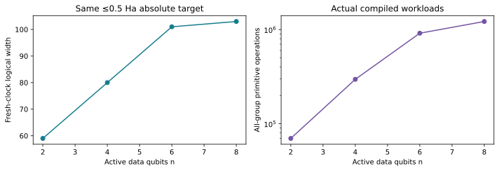

## Motivation and intuition

Molecular energies appear as eigenphases of Hamiltonian evolution. Phase estimation converts those phases into measured bitstrings; state preparation determines which energy is likely to appear. A Hartree–Fock state can overlap strongly with a small molecule's ground state, but that overlap is an input to the success calculation rather than a free guarantee {cite:p}`energy_molecular_qpe_2005,energy_eigenvalues_1999`.

This chapter connects the classical Hamiltonian input, actual controlled gates, preparation, phase resolution, repeated measurements and classical decoding. It also makes a confidence distinction visible: the minimum of many raw QPE samples can select a low-energy tail outlier. Our protocol takes a median of repeated QPE rounds on the **same retained target**, then the minimum across independently prepared groups.

:::{note} Implemented scope
A verified two-qubit H₂ fixture and explicit dimer evolution supply the first example. The fundamental repeated-access circuit, analytic-power variant and recycled-clock instrument are implemented and checked; a separate [Pauli-access variant](energy-estimation/pauli-access.md) constructs full four-qubit product-formula evolution. Large generated circuits and conditional physical projections have separate evidence labels. The example is deliberately coarse in energy resolution. Fresh SCF/mapping, general molecular state preparation, hardware initialization and certified synthesis remain outside the present physical estimate.
:::

## Input, molecular model and output

The task is the energy of a finite-basis Hamiltonian with nuclei fixed at the stated geometry. Basis/model errors are separate from quantum phase accuracy. The stored input is neutral H₂ at a separation of **0.735 Å**, STO-3G basis, with a closed-shell RHF preparation. We use the numerical fixture from the official [Qiskit Nature repository](https://github.com/qiskit-community/qiskit-nature/tree/d86d4a0306f8f4af8918c9eb9e3eae4622192f45), credited under Apache-2.0 {cite:p}`energy_qiskit_nature_fixture`.

The inspected checkout is tag 0.7.2, released on February 23, 2024. The cached notebook execution dates to April 6, 2023 and records Qiskit Nature 0.6.0 and Python 3.9.16; its PySCF version is not recorded. This project loads the stored coefficients; it does not rerun SCF or charge that preprocessing as measured work. The [fixture metadata](../assets/generated/energy-estimation/molecular-fixture.json) records exact source paths, commit and notebook digest. All cited notebook cell indices are zero-based.

In this four-spin-orbital fixture, fixing the alpha and beta parities selects exactly $N_\alpha=N_\beta=1$ and removes original parity wires 1 and 3. Parity tapering generally selects particle-number parities, not exact particle numbers. The reduced space has $M_S=0$ and includes multiple total-spin sectors; it is not a singlet projection. Pauli labels read `q1 q0`. The electronic Hamiltonian is

$$H_{\mathrm{el}}=c_0I+c_1Z_0+c_2Z_1+c_3Z_0Z_1+c_4X_0X_1,$$

with $(c_0,c_1,c_2,c_3,c_4)$ approximately
$(-1.052373246,0.397937425,-0.397937425,-0.011280104,0.180931200)$ Ha.
The separately stored nuclear repulsion **0.7199689944489797 Ha** is added to the identity coefficient for total energies. Full-precision values are in the implementation and fixture JSON.

Hartree–Fock is the reduced state $|01\rangle$, prepared with **X(q0)**. Independent diagonalization gives total ground energy approximately **−1.1373060357534 Ha**, HF energy **−1.1169989967540 Ha**, and ground weight $w_0\approx0.987559734367486$. No ground eigenvector is loaded into a gate.

The output is one classical ground-energy estimate with a stated **ideal** absolute error and failure probability. The native physical report is conditional and does not establish hardware confidence for that output.

## Fundamental algorithm and actual Hamiltonian access

A CX from q0 to q1 stores parity on q1. Conjugation transforms the nonidentity terms into

$$c_3Z_p+(c_1+c_2Z_p)Z_d+c_4X_d.$$

For parity $p=0,1$, define $a_p=c_1+(-1)^pc_2$, $\omega_p=\sqrt{a_p^2+c_4^2}$ and $\theta_p=\operatorname{atan2}(c_4,a_p)$. Conditional chronological gates
$R_Y(-\theta_p),R_Z(2\omega_pt),R_Y(\theta_p)$ implement that sector's evolution. A parity RZ, the coherent identity phase and the inverse CX finish $e^{-iHt}$. These gates come from the specified Pauli coefficients, without matrix-exponential or eigenvector gates.

```{embed} #energy-dimer-access
```

Let $\beta$ be the sum of nonidentity coefficient magnitudes, $c_I$ the total identity coefficient, $E_s=c_I-2\beta$ and $W=4\beta$. The spectrum maps into $[1/4,3/4]$ through

$$U=\exp\!\left[2\pi i(H-E_sI)/W\right],\qquad E=E_s+W\phi.$$

The scalar phase from $E_s$ is retained when U is controlled. Dropping it changes the decoded energy. Standard QPE applies every controlled $U^{2^j}$ as actual repeated U calls, then an inverse QFT and clock readout. With $m$ clock bits, the ideal one-round event $|\widehat E-E|\le W/2^m$ has probability at least $8/\pi^2$ {cite:p}`prim_qpe_1998`.

## Small circuit and retained-target confidence

The diagram shows **one round with three clock bits**, five total wires and seven actual controlled U calls. The complete primitive exports remain downloadable.

```{embed} #energy-small-qpe
```

Within a group, R odd QPE rounds use fresh clocks on the **same target**. Their joint outcome law is a spectral mixture of conditional IID phase distributions. Repreparing HF every round would instead multiply mixed marginals and would invalidate this median contract. Fresh-clock measurements can be deferred until all rounds finish; the baseline is consequently a static circuit accepted by the current estimator.

A group median fails its phase interval with bound

$$b_R=\sum_{j=(R+1)/2}^{R}{R\choose j}(1-p_0)^jp_0^{R-j},\qquad p_0=8/\pi^2.$$

Across K independent HF groups, take the minimum of group medians. If every median is close to its sampled eigenenergy and at least one group samples the ground component, that minimum is within the same error of the true ground energy. Thus

$$\Pr(\mathrm{failure})\le(1-w_0)^K+Kb_R.$$

The default has **m=5, R=19, K=2**, grid error **0.123510769 Ha** and ideal failure bound about **0.002188998**. This confidence requires exact analytic-angle access and the stated overlap promise; it is independent of the physical-fault budget. The coarse resolution is not a chemical-accuracy result.

```{embed} #energy-estimation-results
```

The seeded gate-level sequential check reports about **−1.19698 Ha**, within the ideal grid tolerance of the independent ground answer. Finite-grid QPE estimates can fall below the true energy; this estimator is not a variational upper bound. An independent binomial/spectral calculation supplies the whole reported-energy distribution.

```{embed} #energy-estimation-distributions
```

## Important variants

[Analytic dimer powers](energy-estimation/analytic-powers.md) construct each power directly from its longer evolution angle. They solve the same known dimer task with fewer actual power circuits; such fast-forwarding is a property of this explicit family, not generic Hamiltonian-oracle access.

[Recycled clocks](energy-estimation/recycled-clock.md) implement actual intermediate measurements and resets, retaining the same data. They reduce the default logical width from 97 to 7. Their physical reset/instrument estimate remains unavailable; logical width alone does not establish physical improvement.

[Generic Pauli product formulas](energy-estimation/pauli-access.md) include full four-qubit JW H₂ access, term basis changes, parity accumulation and controlled rotations. Time-discretization error and approximate-unitary eigenstates differ from this exact dimer protocol and have separate numerical/bound evidence. General state preparation and interval-wide synthesis certification remain planned.

## End-to-end resource analysis

### Space, time and size parameters

For D independent active dimers, mapped data width is $n=2D$. Every dimer is prepared and evolved. This family omits intermolecular interactions and is also easy to solve classically. It is used to expose generated-circuit scaling, not a molecular speedup.

The controlled dimer-access cost is $O(n)$. Repeated-access QPE uses $R(2^m-1)$ base calls per group, so quantum gate work scales as

$$O\!\left(KR[n2^m+m^2]\right),$$

including Fourier work, with fresh-clock width $n+Rm$. HF preparation adds $K n/2$ X gates. The product HF ground weight is $w_0^D$; without improved preparation, required groups can grow as $1/w_0^D$. Increasing n also increases W, so holding absolute energy error fixed requires $2^m\gtrsim W/\epsilon$, rather than reusing a fixed resolution.

The [actual compiled size sweep](../assets/generated/energy-estimation/scaling.csv) uses n=2,4,6,8 with a common coarse **0.5 Ha** absolute target and the same ideal failure allocation. Each case publishes its real measured circuit, counts and conditional physical report. The large rows are generated/projected; their full static-register statevectors are unexecuted.



### Default workload and physical baseline

The full default static group has **97 logical wires**, 95 final phase measurements, one HF preparation and 589 base U calls. Two serial groups charge **190 phase readouts**, two preparations and **1,178 base U calls**. The [ledger](../assets/generated/energy-estimation/logical-resources.json) records primitive counts, dependency depth, source/circuit digests, environment and CPU construction timing. Every rejected/outlier phase outcome is retained in the workload.

The [surface-code report](../assets/generated/energy-estimation/surface-code.json) uses the existing illustrative profile $p=10^{-4}$, 100 ns gates and 500 ns measurements. A **0.005 whole-workload physical-fault allowance** spans all groups; a separate **$10^{-5}$ per-group synthesis-model allowance** selects QDK's mean-fit rotation costs. Peak qubits are reused serially; runtime multiplies by K. All source gates, input X preparation and final phase measurements are imported.

```{embed} #energy-resource-ledger
```

**The physical estimate excludes fresh logical-zero initialization/reset cost, SCF/mapping, classical compilation and readout/communication latency.** QDK abstracts Clifford scheduling and supplies no concrete angle-synthesis sequence or output-error certificate. The [physical size reports](../assets/generated/energy-estimation/surface-code-scaling.json) and [matched access comparison](../assets/generated/energy-estimation/access-comparison.json) remain conditional models, with hardware energy-confidence fields false. They do not inherit a hardware success guarantee from the ideal median theorem or claim superiority over the different Grover task.

## Verification and formalization

Independent checks compare the actual two-qubit gate access with SciPy matrix exponentiation, controlled powers with direct matrix powers including identity phase, complete small retained-target circuits with a spectral joint law, and reset instruments with the deferred static circuit. The fixture's original four-qubit particle sector independently matches the stored reduced matrix. Additional random coefficients, complex states and multiple active dimers test signs, basis order and normalization.

The canonical default is sampled by a bounded **seven-wire sequential gate/projection simulator**, preserving the target between rounds. This evaluates the output law of the deferred 97-wire circuit; it does not allocate a $2^{97}$ statevector or validate arbitrary input-register semantics. Small complete 11-wire circuits are separately simulated. Dense references stop at eight data qubits, complete statevectors at 14 wires and sequential runs at 1,024 rounds.

No Lean formalization is integrated for these circuits. The ideal spectral-mixture/median reasoning and numerical tests do not certify compiled hardware. Proof artifacts would need an exact theorem, input domain, source correspondence and reproduced toolchain.

### Recorded native computation and routine CI

The six native energy resource records were computed in a separate bounded CPU job with Python 3.12.14 and the full environment lock. The complete producer finished in **91.60 seconds**, with two explicitly selected CPUs and peak resident memory **12,803,256 KiB (12.21 GiB)**. This is classical estimation-process memory, separate from the modeled quantum space. The [immutable record manifest](../assets/generated/energy-estimation/resource-record-manifest.json) binds the exact saved files, producer and verifier sources, environment, seed and successful completion evidence. Its native producer commit identifies the measured source snapshot; the published source has matching content hashes.

Routine CI runs the current producer with native resource estimation disabled in a fresh temporary directory. It reconstructs the logical circuits, bounded samples and classical checks, compares the QASM and logical evidence, authenticates the saved native records and independently checks their model arithmetic. It preserves the native factory choices and Pareto records; it does not repeat their search. Changed producer, lock, verifier or record bytes require a reviewed new freeze. The same physical exclusions and false synthesis/hardware-certificate flags apply to both the recorded computation and this replay.

The four single-round spectral-reference arrays admit a nominal absolute replay tolerance of $10^{-12}$ for floating-point differences between hosts. Their shapes, order, ranges, normalization and fixed-weight marginal relation are checked. For the fixed 11-wire test (one dimer, three phase bits and three rounds), each reported maximum joint-probability residual must satisfy the producer's existing $10^{-12}$ bound. Sampled outcomes, weights, all remaining result fields, circuit exports, budgets and immutable file hashes retain exact comparisons. These numerical checks are separate from the quantum error allocations.

The production verifier completed in **46.52 seconds** on GitHub's Ubuntu 24.04 runner with the locked environment and two available CPUs. Its external supervisor recorded a wait-derived peak of **541,300 KiB (528.61 MiB)** for the verifier or its producer child. These measurements describe classical reconstruction and record checking; they are separate from quantum runtime.

Run the [notebook](../notebooks/energy_estimation.ipynb) with the pinned Python environment and public code package. The implementation is original MIT code using Qiskit 2.6.2 core (Apache-2.0), NumPy/SciPy and the audited QDK 1.34.0 adapter {cite:p}`energy_qiskit_262`. Only stored data are adopted from Nature; it is not a runtime dependency.

```bash
python scripts/generate_energy_estimation.py
pytest tests/test_energy_estimation.py tests/test_energy_estimation_generator.py
python scripts/generate_energy_estimation.py --analytic-powers --phase-bits 12 \
  --no-sim --no-scaling --no-estimate --output-dir artifacts/h2-high-resolution
```

Generation is capped separately at 12 active dimers, 12 phase bits, 31 median rounds, 256 total static wires and 750,000 primitive operations. Accepted parameters are not a promise of affordable simulation. Public [source](../assets/generated/energy-estimation/energy_estimation.py), [generator](../assets/generated/energy-estimation/generate_energy_estimation.py), [measured static group](../assets/generated/energy-estimation/measured-group.qasm), [recycled instrument](../assets/generated/energy-estimation/recycled-clock.qasm), [fixture](../assets/generated/energy-estimation/molecular-fixture.json) and [results](../assets/generated/energy-estimation/results.json) preserve the calculation.
