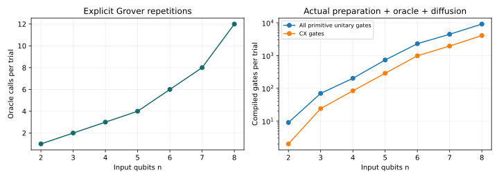
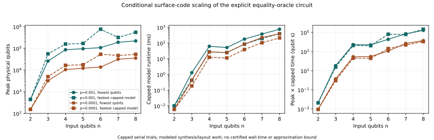
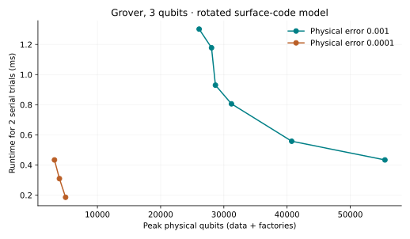

## Motivation and intuition

Grover search amplifies the probability of a marked item using a reversible predicate and a reflection about a uniform superposition {cite:p}`grover1996`. It is a useful first implementation because its circuit is small enough to inspect and its ideal success probability has a closed form. The survey gives the broader application and end-to-end complexity context {cite:p}`survey2025`.

```{note}
Implementation status

The three-qubit demo is simulated and checked against the mathematical prediction during the site build. The generator supports other sizes. The exported circuit includes the oracle and diffuser decomposed into gates; the fixed three-qubit circuit compiles to exact Clifford and T operations, while larger circuits can require arbitrary-angle synthesis. The [in-page surface-code baseline](#end-to-end-resource-analysis) records the physical assumptions and estimator output.
```

## Problem and input model

There are $N=2^n$ computational basis states and exactly one marked state $m$. The phase oracle applies $-1$ to $\lvert m\rangle$ and leaves every other basis state unchanged. Our explicit oracle compares the register to a known integer using X gates and a multi-controlled phase flip. This is a teaching example: knowing the target already solves the classical problem. A practical search application must replace it with a reversible problem predicate and count that predicate's construction, evaluation, and uncomputation.

The notebook uses **Qiskit core**, an open-source circuit library released under Apache 2.0. The circuit generator is an original implementation using Qiskit core. See the [upstream repository](https://github.com/Qiskit/qiskit) and the [downloadable implementation source](../assets/generated/grover/grover.py).

## Fundamental algorithm and complexity

Prepare the uniform state with $H^{\otimes n}$. Repeat the phase oracle followed by reflection about that uniform state, then measure and verify the candidate. The two reflections rotate the state toward the marked subspace: the phase flip changes relative signs, and the diffuser converts that sign change into increased marked-state amplitude.

For one marked item among $N=2^n$, the first success peak uses $\Theta(\sqrt N)$ oracle calls {cite:p}`grover1996`. Register width $n$ and candidate count $N$ are different size parameters. An oracle call is not a fixed gate cost: if its actual reversible construction costs $C_O(n)$ and diffusion costs $C_D(n)$, one trial costs preparation plus $r[C_O(n)+C_D(n)]$ and readout. The equality oracle below has its own explicit decomposition; an application predicate requires a separate ledger.

Amplitude amplification generalizes the uniform input to a specified preparation circuit and success predicate. Its preparation inverse and reflections must be implemented and counted. This page implements the single-target Grover case; [oblivious amplification in dynamics](simulation/amplification.md) is a separate construction and task.

## Small circuit: find 101

We prepare three qubits in the uniform superposition, mark integer 5 (bitstring `101`), and apply two Grover iterations. Qiskit displays bitstrings with the most significant bit first; circuit wire `q[0]` represents the least significant bit.

The circuit below is reused directly from the saved output of the executable notebook.

```{embed} #grover-circuit
```

Let $\theta=\arcsin(1/\sqrt{N})$. After $r$ iterations, the ideal probability of the marked state is

$$P(m)=\sin^2((2r+1)\theta).$$

For $N=8$ and $r=2$, this is $0.9453125$. The exact statevector simulation checks this value. Sampling a real device would additionally introduce shot noise and device errors.

```{embed} #grover-probabilities
```

## Interactive exploration

Change the register size and iteration count in the browser explorer to inspect the ideal marked-state probability and the first success peak. This explorer evaluates the analytic formula. The saved figures above come from the Qiskit notebook.

::::{div}
:class: grover-explorer

```{iframe} /OpenQuantumAlgorithms-site/interactive/grover.html
:width: 100%
:title: Grover probability explorer
```

::::

[Run the notebook in Binder](https://mybinder.org/v2/gh/xujue-AI/OpenQuantumAlgorithms-site/gh-pages?urlpath=lab/tree/notebooks/grover.ipynb) for live Python controls that regenerate the actual Qiskit circuit and statevector. The controls support 2–6 qubits, an adaptive marked value, and 0–12 iterations. Every evaluation checks the simulated success probability against the closed form. The public notebook and its standalone implementation run independently of the private source repository.

The Binder recipe pins the scientific demo dependencies and uses Python 3.12. Its environment excludes the QDK resource estimator; physical estimates use the separate build environment and the [surface-code baseline](#end-to-end-resource-analysis).

## Run and generate other sizes

The downloadable notebook uses the same package implementation as the build script. To run the downloads independently, save [grover.py](../assets/generated/grover/grover.py) beside {download}`grover.ipynb <../notebooks/grover.ipynb>` and install the scientific dependencies listed in the [Binder environment](../binder/environment.yml). The [generated metadata](../assets/generated/grover/logical-resources.json) records the versions used by this build. From a source checkout, run:

```bash
python scripts/generate_grover.py
pytest tests/test_grover.py
```

```python
from qiskit.quantum_info import Statevector
from openquantum.grover import build_grover_circuit

circuit = build_grover_circuit(n_qubits=3, marked=5, iterations=2)
probabilities = Statevector.from_instruction(circuit).probabilities_dict()
print(probabilities["101"])
# Approximately 0.9453125
```

To generate a larger register without simulating its exponentially large statevector:

```bash
python scripts/generate_grover.py --qubits 12 --marked 17 \
  --no-sim --no-scaling --output-dir artifacts/grover-12
```

Circuit generation and decomposition also consume time and memory; a large register does not imply an affordable classical simulation. The first Grover peak needs approximately $\pi\sqrt{N}/4$ iterations, so even constructing a fully expanded circuit grows rapidly. For estimates beyond practical expansion sizes, an independently checked symbolic cost model is a separate deliverable.

## Logical counts and physical resources

The generator transpiles the complete circuit into H, X, Z, S, T, their inverses, rotations, and CX. It records qubit width, depth, oracle calls, and the exact gate counts for the chosen Qiskit version and compilation settings. **Every multi-controlled gate is decomposed before estimation.** The OpenQASM 3 export contains decomposed gates and final measurements.

These logical counts are not physical qubit counts. A fault-tolerant estimate must specify rotation precision, logical error budget, code distance, state-distillation factories, timing, and failure probability. The [surface-code baseline](#end-to-end-resource-analysis) performs that handoff for this concrete circuit.

The scaling CSV covers 2–8 qubits with the all-ones target. It contains decomposed circuit counts rather than simulated large-register results. Changing the target changes which X gates are needed, and compilation choices can change gate counts.

## End-to-end resource analysis

The first baseline estimates the circuit from this chapter: initialization, the explicit equality predicate, diffusion, and final measurements. It uses the open-source [Microsoft Quantum Development Kit](https://github.com/microsoft/qdk) and its local `qdk.qre` estimator. The baseline is a gate-based rotated surface code with round-based magic-state factories.

These results describe an **illustrative hardware model**. They do not establish an application speedup or a measured hardware performance guarantee. The equality oracle tests a known three-bit string; an application predicate or database access would need its own implementation and cost.

### Scaling with register size

For $k$ complete serial trials at width $n$ and iteration count $r(n)$, the logical gate workload is

$$G_{\rm total}(n)=k\bigl[G_{\rm prep}(n)+r(n)(G_O(n)+G_D(n))+G_{\rm readout}(n)\bigr].$$

The [2–8-qubit data](../assets/generated/grover/scaling.csv) measures the actual decomposed oracle/diffuser workload with a specified marked bitstring. It is circuit-generation evidence. The simulator below is deliberately bounded; its exponentially large statevector memory is a classical verification cost, not quantum circuit space.

Physical space/time depends additionally on synthesis precision, code distances, factory allocation and scheduling. Report peak physical qubits $Q_{\rm peak}$, serial runtime $T$ and their product $Q_{\rm peak}T$ as a rectangular space-time proxy; the product is not the integral of occupancy over time.

The new [size sweep](../assets/generated/grover-scaling/grover-scaling.json) computes every $n=2,\ldots,8$ case under both frozen hardware profiles: 14 cases and 67 Pareto points. It uses alternating marked bits, retaining `101` at $n=3$, and iteration counts $1,2,3,4,6,8,12$. Both numerical $n=3$ frontiers and its exact 28-T/three-measurement circuit agree with the frozen baseline below. This is bounded computed scaling, not an asymptotic fit or practical search advantage.





For $n=4,\ldots,8$, arbitrary rotations use a $10^{-4}$ per-trial synthesis-model allowance. The QDK mean fit supplies no concrete approximation or runtime-tail certificate. Success projections are conditional on that scalar bounding output-distribution variation; certified confidence remains unavailable. The cap reserves 0.005 for missed output and 0.005 for physical faults across **all capped trials**. A higher success peak can reduce the cap, so the physical curve need not be monotone in every parameter.

The report separately gives ideal and synthesis-conditional stopped expectations $(1-(1-p)^R)/p$. These assume independent trials and immediate correct classical verification without physical faults. They do not replace the cap-based physical budget. Verification/control, external data access and hardware routing latency remain unmeasured. [All physical points](../assets/generated/grover-scaling/physical-pareto.csv), [summary choices](../assets/generated/grover-scaling/physical-summary.csv), individual measured circuits and model reports are downloadable.

### Computed baseline

```{include} ../assets/generated/resources/table.md
```



Every plotted point is a returned estimator result, with its physical qubit count, runtime, factory information, model properties, and instruction provenance preserved in the report. The two summary choices can coincide for a small circuit.

The three algorithm qubits do not translate into three logical compute qubits under the estimator's scheduling model. Its logical ancillas, data code distance, and factories contribute to the physical count. These overheads can dominate a very small circuit; they are included rather than amortized over an unspecified larger workload.

For this instance, the exported rotations are exact Clifford or T operations. The QDK canonical application trace requires **28 T states and three measurements**, with no arbitrary-angle rotation synthesis. The estimator abstracts Clifford work and scheduling into its resource model, so the reported runtime is a model estimate rather than an exact schedule of the original Qiskit circuit. The initial pipeline rejects arbitrary-angle traces until their approximation-error budget is specified.

[Download every Pareto point as CSV](../assets/generated/resources/grover-surface-code.csv) · [Download the full report as JSON](../assets/generated/resources/grover-surface-code.json) · [Download the estimated OpenQASM circuit](../assets/generated/grover/circuit.qasm) · [Download the estimation script](../assets/generated/resources/estimate_resources.py)

### Hardware and error assumptions

The two profiles use physical error rates of $10^{-3}$ and $10^{-4}$, 100 ns gate time, and 500 ns measurement time. These are editable model inputs, not benchmarks from a specific processor. The estimator explores the rotated surface-code and round-based factory model combinations and returns a Pareto frontier.

For the default example, one state is marked among eight and two Grover iterations are used. The ideal success probability per circuit execution is

$$
p_{\mathrm{success}} = \sin^2\!\left(5\arcsin(1/\sqrt{8})\right) = 0.9453125.
$$

We set an overall failure target of 1%, reserve 0.5% for sampling failure and 0.5% for physical faults, and run two trials serially. Ideal sampling failure is $(1-p_{\mathrm{success}})^2\approx0.002991$. Each trial receives a physical-failure allowance of 0.25%. A union bound gives overall failure at most 0.7991% under the declared model and ideal verification assumptions. The report records the tighter bound from each returned estimate.

Peak physical qubits remain the per-trial peak because trials run serially. Runtime is multiplied by two. Quantum measurement time is included; classical verification and circuit compilation time are currently unmeasured and excluded. An application with input loading or a more complex predicate must extend this boundary before its estimate can be called end to end.

### Reproduce and inspect

In a project checkout:

```bash
python scripts/generate_grover.py
python scripts/estimate_resources.py
```

To reproduce using only public downloads, save the [OpenQASM circuit](../assets/generated/grover/circuit.qasm), [matching circuit metadata](../assets/generated/grover/logical-resources.json), [estimation script](../assets/generated/resources/estimate_resources.py), and [locked Python dependencies](../requirements-lock.txt) in one directory. In a Python 3.12 environment, run:

```bash
python -m pip install -r requirements-lock.txt
python estimate_resources.py --qasm circuit.qasm \
  --logical-metadata logical-resources.json \
  --output-dir resource-results --cache-dir estimator-cache
```

The estimator consumes the fully decomposed OpenQASM 3 file and records its SHA-256 digest. It rejects missing measurements and remaining custom gate declarations. Changing the qubit count or iteration count requires generating a matching circuit and passing matching `--n-qubits`, `--marked`, and `--iterations` arguments to the estimator. Package versions are embedded in the report.

The baseline uses the documented [local estimator installation](https://learn.microsoft.com/en-us/azure/quantum/install-run-resource-estimator), [OpenQASM application interface](https://learn.microsoft.com/en-us/azure/quantum/qre-supported-applications), [QEC and factory models](https://learn.microsoft.com/en-us/azure/quantum/qre-build-error-correction-models), and [result quantities and provenance](https://learn.microsoft.com/en-us/azure/quantum/qre-estimation-results). `EstimationTableEntry.runtime` is reported in nanoseconds and converted to milliseconds on this page.

### Next baseline extensions

- Add explicit reversible application predicates and state preparation, with loading and classical-output costs.
- Use [Qualtran](https://github.com/quantumlib/Qualtran) for symbolic large-instance logical resource counts; validate the handoff against small compiled circuits before physical estimation. Qualtran is an experimental preview, so pin versions and verify cost formulas.
- Compare factory choices, arithmetic, synthesis precision, and scheduling under the same input instance and error target.
- Calibrate selected surface-code memory experiments with [Stim](https://github.com/quantumlib/Stim), [Sinter](https://github.com/quantumlib/Stim/tree/main/glue/sample), and [PyMatching](https://github.com/oscarhiggott/PyMatching). Stim supports stabilizer operations and does not directly simulate T gates or Toffoli gates.
- Compare later co-designs using matched assumptions and physical qubit/runtime frontiers, retaining this surface-code report as the reference.

## Verification and formalization

The tests verify that the oracle flips exactly the requested basis state, that simulated success matches the closed form for several register sizes and iteration counts, and that decomposition preserves the unitary up to global phase. These are numerical and functional checks.

Formal proof coverage is **not yet integrated**. The [SQIR/VOQC project](https://github.com/inQWIRE/SQIR) provides relevant quantum algorithm proofs in Coq/Rocq; a linked proof does not establish correctness of this Python generator or its surface-code compilation. Any later proof badge must record the theorem, assumptions, pinned proof toolchain, successful proof build, and connection to this circuit.

**Status: small circuit and resource contracts checked; no integrated formal proof.** The [implementation](grover.md) uses an explicit equality phase oracle, whose marked integer is known to the generator. This is a teaching instance for circuit correctness.

### What is checked

The 22 dedicated Grover test cases cover oracle signs on computational basis states, invalid inputs, bit ordering, ideal success probabilities, and decomposition into the supported logical basis. Oracle matrices are compared with an independently specified diagonal matrix. Simulation results are compared with

$$
P(m)=\sin^2\!\left((2r+1)\arcsin(1/\sqrt{2^n})\right).
$$

The three-qubit case with target `101` and two iterations has ideal probability $121/128=0.9453125$. The compiled circuit is compared with the original unitary up to global phase. These are numerical checks over the tested instances, not a proof for every register size.

The notebook also checks 30 bounded cases for its live controls. Every interactive evaluation verifies the simulated marked-state probability against the same analytic expression. Saved circuit and probability outputs are reused in the chapter; a static page does not execute the Python controls.

### What resource checks establish

The 13 baseline-contract test cases check repetition arithmetic, allocation between ideal sampling failure and modeled physical faults, and rejection of opaque or unmeasured inputs. The [frozen resource report](#end-to-end-resource-analysis) records the actual circuit digest and assumptions.

The seven general-resource-helper cases separately check static lowering, budget semantics, rejected operations, and the audited arbitrary-rotation model. That helper's mean-fit projections are conditional and do not certify concrete synthesis sequences. Its tests do not expand the proof scope of the frozen Grover instance.

### Remaining evidence

A practical search predicate needs its own reversible implementation, independent semantic checks, loading cost, and classical verification procedure. An integrated theorem would need to identify its mathematical object, assumptions, toolchain, and connection to this Python circuit. External [SQIR/VOQC proofs](https://github.com/inQWIRE/SQIR) are relevant references; this project has not reproduced a proof that covers the implementation and its physical compilation.

See [fault-tolerance background](../appendices/fault-tolerance.md) for the distinction between circuit accuracy, sampling confidence, and modeled physical reliability.

## Downloads and provenance

- {download}`Executable notebook <../notebooks/grover.ipynb>`
- [Open the rendered notebook](../notebooks/grover.ipynb)
- {download}`Binder environment <../binder/environment.yml>`
- [Decomposed measured circuit, OpenQASM 3](../assets/generated/grover/circuit.qasm)
- [Logical counts, parameters, and package versions](../assets/generated/grover/logical-resources.json)
- [2–8-qubit scaling data](../assets/generated/grover/scaling.csv)
- [Circuit generator](../assets/generated/grover/grover.py)
- [Implementation license (MIT)](../assets/generated/grover/LICENSE.txt)

The algorithm exposition and implementation on this page are original. The underlying circuit library is credited above; the original algorithm and survey are cited in the bibliography. Every generated resource result records its exact input, implementation version, and assumptions.
