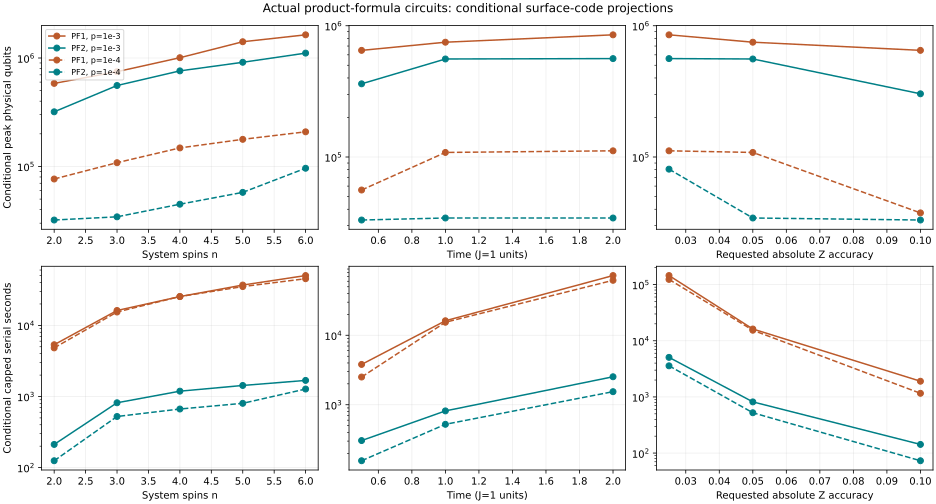
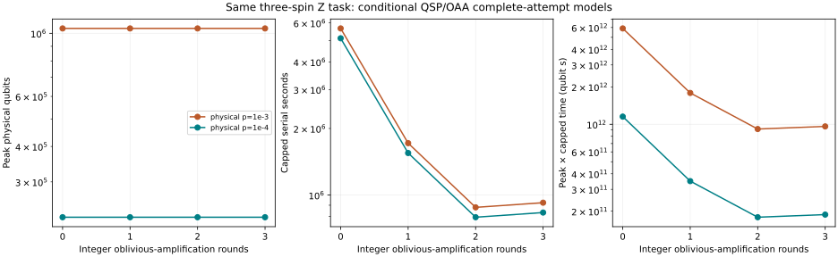
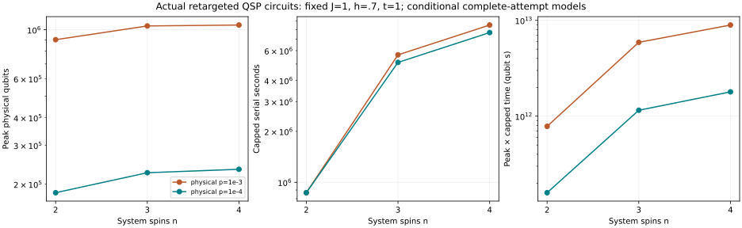

(hamiltonian-methods-motivation)=
## Motivation and intuition

This chapter implements a small dynamics task with original gate construction and an independent classical answer. It belongs to the [quantum-simulation umbrella](quantum-simulation.md); [open systems](simulation/open-systems.md) and [Gibbs preparation](simulation/gibbs-preparation.md) have separate tracks.

Hamiltonian simulation offers several ways to approximate the same evolution,
but each produces a different mix of rotations, controlled access, arithmetic
and measurements. Those operations determine which fault-tolerant architecture
is worth comparing. The number of oracle calls alone cannot select a code or
predict physical runtime.

:::{note} Implementation status
First- and second-order product formulas implement dynamics with state, operator and observable checks. Aggregated Taylor LCU has actual PREPARE/SELECT, uncomputation and a measured/reset postselection schedule. A separate structured word-Taylor method supplies term-index access and integer-round oblivious amplification without enumerating every word. Qubitization access, a standalone degree-14 QSP cosine filter, complex postselected evolution and a separate integer-round oblivious-amplification path are checked. The [computed static study](#computed-static-surface-code-study) supplies conditional surface-code projections for product formulas and complex QSP/OAA. Separate [one-system word-Taylor](simulation/word-taylor.md#conditional-one-system-fault-tolerant-baseline) and [one/two-spin retargetable-QSP](simulation/retargetable-qsp.md#complete-observable-workload-and-conditional-physical-resources) studies supply actual Clifford+T sequences and conditional reset-aware physical models. Aggregated Taylor and wider word-Taylor physical costing, deterministic evolution and certified synthesis remain planned. No hardware advantage or formal proof is claimed.
:::

## The fixed task

Use three spins on an open chain with

$$
H=A+B,\quad A=Z_0Z_1+Z_1Z_2,\quad B=0.7(X_0+X_1+X_2).
$$

The coupling $J=1$ defines the energy unit, $\hbar=1$, and time is $t=1$ in inverse coupling units. Prepare $|\psi_0\rangle=|000\rangle$. The state task approximates $U(t)|\psi_0\rangle$ for $U(t)=e^{-iHt}$; the observable task estimates $\langle Z_0\rangle$ after evolution. These outputs have different repetition costs. The exact small classical observable is approximately **0.404255857287**.

The input is an explicit Pauli coefficient list. Qiskit labels read `q[2] q[1] q[0]`: the terms are `IZZ`, `ZZI`, `IIX`, `IXI`, `XII`. The observable assigns $+1$ to bit 0 equal to zero and $-1$ to bit 0 equal to one. The zero basis input needs no preparation gates; a device still needs initialization. No external data loading is modeled.

For an approximation $V$, report spectral operator error $\|V-U\|_2$, state-vector error $\|V\psi_0-U\psi_0\|_2$, state infidelity and observable bias separately. Vector error retains phase; infidelity does not. For normalized states, a state-vector error $\epsilon$ bounds this observable bias by $2\epsilon$.

## Fundamental method: product formulas

The Hamiltonian terms are easy to exponentiate individually even when their sum is not. Product formulas alternate those simple rotations. Shorter steps reduce the mismatch caused by noncommutation; a symmetric schedule cancels the leading splitting error. The fixed example below makes that error visible against exact small-system evolution.


Let $\delta=t/r$. Applying an $A$ layer followed chronologically by a $B$ layer gives

$$V_1(t;r)=\left(e^{-iB\delta}e^{-iA\delta}\right)^r.$$

Applying half an $A$ layer, a full $B$ layer and half an $A$ layer gives

$$V_2(t;r)=\left(e^{-iA\delta/2}e^{-iB\delta}e^{-iA\delta/2}\right)^r.$$

These are Lie–Trotter and symmetric Strang splittings {cite:p}`sim_trotter_1959,sim_strang_1968`. Modern commutator bounds explain their approximation error {cite:p}`sim_trotter_error_2021`; the curves here are numerical results for this instance.

Terms within each layer commute. Each $e^{-ic\delta Z_iZ_{i+1}}$ uses CX–$R_Z(2c\delta)$–CX; each $e^{-ic\delta X_i}$ uses $R_X(2c\delta)$. Half layers halve the angle. The generator uses these primitive operations directly and never appends a dense evolution gate.

```{embed} #simulation-product-formula-circuit
```

The figure shows one symmetric step; the accuracy run uses $r=32$. An independent Kronecker-product Hamiltonian and SciPy matrix exponential supply the dense reference {cite:p}`sim_expm_2009,sim_scipy_1181`. Qiskit Operator and Statevector evaluate the actual circuit {cite:p}`sim_qiskit_262`.

```{embed} #simulation-product-formula-convergence
```

```{embed} #simulation-product-formula-results
```

At 32 symmetric steps, operator error is approximately $5.0261\times10^{-4}$, state-vector error $4.0545\times10^{-4}$ and observable bias $1.5912\times10^{-4}$. Doubling steps in the tested range approximately halves the first-order operator error and quarters the second-order operator error.

The two formulas give equal $Z_0$ expectations on this input although their states and operators differ. Here $V_2=e^{-iA\delta/2}V_1e^{+iA\delta/2}$; the initial state is an eigenstate of $A$ and $Z_0$ commutes with $A$. Boundary phases are invisible to this observable. An observable-only check would miss the first-order circuit's larger evolution error.

## Taylor LCU with actual access

For a segment $\delta=t/r$, form

$$T_K(\delta)=\sum_{k=0}^K\frac{(-i\delta H)^k}{k!}=\sum_j b_j P_j,\qquad s=\sum_j|b_j|.$$

Bounded classical preprocessing multiplies Pauli strings, combines identical strings and removes only exact floating-point zeros. Its actual normalization differs from the unaggregated word-series normalization. This preprocessing can grow exponentially; it is not the scalable word-indexed access model of the truncated-Taylor algorithm {cite:p}`sim_taylor_lcu_2015`.

A binary tree of controlled $R_Y$ rotations implements

$$\mathrm{PREPARE}|0\rangle=\sum_j\sqrt{|b_j|/s}|j\rangle.$$

Indexed X/Y/Z gates and coefficient phases implement $\mathrm{SELECT}=\sum_j|j\rangle\langle j|\otimes e^{i\arg b_j}P_j$. Padded labels apply identity. PREPARE, SELECT and inverse PREPARE give a unitary whose zero-label block is $T_K/s$. Tests compare that actual block with an independent polynomial matrix, including negative/complex coefficients and bit ordering.

For $K=4$ and segment counts $r=1,2,4,8$, we check the unnormalized polynomial operator against $U$, the conditional state before final system readout against $U|000\rangle$ and the observable against its exact value. Conditional-state error and acceptance probability are separate.

```{embed} #simulation-lcu-results
```

Every segment must return zero label bits. Ancillas are reset for reuse; an attempt runs all segments and finally measures every system wire in Z. The exported attempt circuits include initial resets, all access/uncomputation, label measurement/reset and final readout; their output is an accepted measured trial. The conditional state checked above describes the system immediately before that final readout. Whole-attempt acceptance is the product of state-dependent conditional probabilities. At eight segments, ideal acceptance is about $0.001015$, requiring thousands of complete attempts for one accepted measured trial with 99% confidence. The ledger also records a capped retry budget for many accepted observable shots, charging the complete schedule each time.

**Amplification of this aggregated demonstration remains planned.** The separate [word-indexed Taylor method](simulation/word-taylor.md) constructs independent term-index registers and actual integer-round amplification; it avoids enumerating and aggregating every Taylor word. State/observable values come from ideal simulation; approximation errors exclude rotation synthesis, physical faults and finite-shot noise. This unamplified demonstration is not an efficiency comparison with product formulas.

## Important variant: structured word-Taylor access

[Structured word-Taylor dynamics](simulation/word-taylor.md) prepares a degree register and one independent Hamiltonian-term register per possible word slot. Signed SELECT operations activate the selected slots and then uncompute the access registers. The construction follows the word-access viewpoint of truncated-Taylor simulation {cite:p}`sim_taylor_lcu_2015`; it supplies gates without constructing the exponentially long classical word table.

The method page checks the actual encoded polynomial, conditional state and acceptance against independent matrix references on a two-spin input. It also implements integer-round oblivious amplification and an explicit zero-LCU padding variant with normalization two. The chosen input, approximation and acceptance remain visible: padding and amplification do not turn the finite Taylor polynomial into exact deterministic evolution. Its complete measured-trial ledger, bounded size study and notebook belong to that method page.

## Important variant: qubitization and QSP

[Qubitization and quantum signal processing](simulation/qsp.md) has its own method page beneath Hamiltonian dynamics. Actual Pauli access encodes $H/\alpha$; reproducible even/odd phases and a selector produce a checked zero-ancilla block near $U/4$. The page includes a three-wire polynomial circuit, the fixed dynamics results, in-page cost and verification analysis, and an executed size sweep at fixed $\alpha t$. A separate [bounded physical study](simulation/qsp.md#computed-bounded-surface-code-study) retargets phases for two, three and four spins at fixed local couplings and time. General size-dependent degree and phase generation remain planned.

The [oblivious-amplification variant](simulation/amplification.md) adds actual forward/inverse access and zero-ancilla reflections. Its success remains probabilistic and retry accounting assumes a freshly re-preparable input. Deterministic evolution and certified synthesis remain planned. The standalone ledgers use different output contracts; the static study below instead fixes the observable accuracy and failure allocations before comparing complete measured workloads.

(hamiltonian-method-map)=
## Further algorithm families and fault-tolerant choices

[Hamiltonian methods and fault-tolerant choices](#hamiltonian-method-families)
connects the checked higher-order, qDRIFT and two-term multi-product companions
with planned corrected formulas, generalized QSP and interaction-picture
methods. It maps their primitive workloads to surface-code factories,
grouped rotation synthesis, STAR and transversal architecture references.
Alternative-architecture comparisons remain **literature-backed plans**.
The method pages retain their checked or planned status and their stated
output and error contracts. Published numbers under another Hamiltonian,
error convention or hardware model are reference points for a new comparison.

:::{note} Comparison status: planned

The [Hamiltonian chapter](hamiltonian-simulation.md) contains the executed
product-formula, Taylor and QSP examples. This overview adds cited algorithm
families and architecture directions. It supplies no new circuit execution,
physical-resource estimate, matched co-design improvement or formal proof.
:::

(hamiltonian-method-families)=
### Fundamental methods and output contracts

An algorithm should be chosen for a specified output and an implemented
Hamiltonian representation. Approximating the full evolution operator,
estimating one observable, and supplying controlled evolution to phase
estimation are different tasks. An error bound for one does not automatically
serve the others. The number of spins alone is also insufficient: simulated
time, term magnitudes, access construction, requested error and confidence
change the workload.

| Method family | Useful structure and main cost | What must be checked before a comparison | Site status |
|---|---|---|---|
| Lie–Trotter and higher-order Suzuki formulas | Direct term exponentials; commutator structure and local scheduling can reduce the required steps | Use a bound for the chosen ordering and output, then synthesize every rotation; higher order can add many substeps | Lie/Strang circuits and the [bounded higher-order Suzuki study](simulation/suzuki.md) are checked; matched physical comparisons remain planned |
| Corrected product formulas | Add compiled correctors to product formulas for two exactly simulatable partitions; small perturbations supply another error parameter | Charge corrector compilation and its residual error; boundary cancellation applies to the analyzed symplectic construction | Planned {cite:p}`ham_corrected_formulas_2026` |
| Randomized formulas and qDRIFT | Sample a term with probability proportional to its magnitude; qDRIFT cost depends on the coefficient l1 norm rather than the term count alone | The qDRIFT guarantee describes an averaged quantum channel; independent circuit samples, classical sampling and all rotations must be charged | [Bounded qDRIFT circuits and averaged-channel study checked](simulation/qdrift.md); broader randomized and physical comparisons planned |
| Multi-product formulas | Combine several product-formula accuracies to cancel leading errors | A coherent LCU construction needs controls, coefficient loading and success/amplification accounting; classical combination supplies expectation values and has statistical overhead | [Fixed two-term coherent and classical circuits checked](simulation/multiproduct.md); optimized high-order, synthesis and physical comparisons remain planned |
| Truncated-Taylor LCU | Coherently select Hamiltonian words and uncompute the selection registers | Construct PREPARE/SELECT, retain normalization and finite-polynomial error, and cost complete amplification or rejected attempts | Small structured and aggregated circuits checked; wider physical studies incomplete |
| Qubitization and QSP | Transform the spectrum of an explicit normalized block encoding; favorable query scaling in time and precision | Include repeated access, normalization, phase construction, synthesis and the exact accepted-output contract | Small QSP circuits and conditional physical studies checked |
| Generalized QSP | General ancilla SU(2) rotations implement complex polynomials of a unitary signal without a fixed parity constraint | Check the unit-circle polynomial bound, complementary polynomial, signal convention and actual synthesized rotations | [Planned GQSP variant](simulation/qsp.md#planned-generalized-qsp-variant) {cite:p}`ham_gqsp_2024` |
| Stochastic QSP | Randomly select polynomial transformations to reduce expected block-encoding queries under the method's coefficient-decay assumptions | Validate the averaged channel and its success contract; charge classical selection, every phase sequence, synthesis and repetitions | Planned {cite:p}`ham_stochastic_qsp_2025` |
| Interaction-picture and hybrid methods | Separate an easily implemented component from the remaining time-dependent interaction | Fast evolution of the large component must be a real circuit; time indexing, controlled access and Dyson-series construction are additional costs | Planned |

Commutator-aware analysis is the appropriate starting point for product
formulas {cite:p}`sim_trotter_error_2021`. qDRIFT provides a distinct randomized
method {cite:p}`ham_qdrift_2019`. Writing
$H=\sum_j h_j H_j$ with $\|H_j\|\leq1$ and
$\lambda=\sum_j|h_j|$, its elementary-evolution count scales as
$O(\lambda^2t^2/\epsilon)$ in the averaged-channel error model. This is not
a guarantee that one fixed seeded circuit has operator error $\epsilon$.
The original paper explicitly distinguishes those errors. A small demo must
therefore compare both individual trajectories and the channel or measured
ensemble, retaining its independently sampled circuits and seeds.

Corrected product formulas add corrector operations to a product formula for
two exactly simulatable partitions {cite:p}`ham_corrected_formulas_2026`.
In the analyzed symplectic construction, inverse correctors cancel between
adjacent steps, leaving boundary work. A compiled comparison must retain
those boundary gates and the error of implementing the corrector itself.
The perturbed-system results also assume a small-norm partition. The paper's
spectral-norm bounds and lattice experiments support a planned variant;
they do not provide resources for this book's circuits or a replacement
for an application's energy-estimation error contract.

Multi-product formulas deserve two separate variants. Coherent
multi-product simulation uses a linear combination of product-formula
circuits {cite:p}`ham_mpf_coherent_2019`; that source remains a preprint with
no peer-reviewed successor found in the checks recorded here. The published
hardware-friendly variant classically combines expectation values from
different circuits {cite:p}`ham_mpf_hybrid_2023`. It supplies an observable
estimate rather than a prepared evolved state or a coherent controlled
evolution. Coefficient conditioning and sampling variance belong in its
end-to-end cost.

The system-size analysis also needs a bounded commutator argument. Mizuta's
2026 result explains why an earlier bound involving arbitrarily high nested
commutators does not establish locality-based size scaling, and supplies a
finite-truncation alternative {cite:p}`ham_mpf_commutator_2026`. The
[fixed two-term companion](simulation/multiproduct.md#finite-error-and-scaling-contract)
uses a conservative finite second-order certificate alongside its observed
fourth-order cancellation. Optimized high-order bounds and physical
comparisons remain planned. This analysis paper is not
a publication successor of the original coherent-MPF preprint.

The existing Taylor and QSP pages provide actual access constructions
{cite:p}`sim_taylor_lcu_2015,sim_qubitization_2019,sim_qsp_2017`. Their
query-complexity improvements do not make an expensive coefficient loader
or SELECT circuit free. For Hamiltonians with a cheaply exponentiated large
component, interaction-picture simulation can change the relevant norm
dependence. The original method is a preprint reference
{cite:p}`ham_interaction_2018`; the published hybrid framework explains both
its opportunities and substantial constant-factor/access tradeoffs
{cite:p}`ham_interaction_hybrid_2022`. This is a separate implementation
track rather than a relabeling of the current QSP circuit.

Martyn and Rall's stochastic QSP replaces one polynomial with a probabilistic
ensemble. Under their exponential Chebyshev-coefficient decay condition, a
degree-$d$ deterministic approximation can be replaced by expected degree
$d/2+O(1)$ while retaining the same order of averaged-channel error
{cite:p}`ham_stochastic_qsp_2025`. The constants and any postselection
normalization still matter for equal-accuracy comparison; an individual
sampled circuit does not inherit the ensemble's error guarantee. The paper
also studies imaginary-time evolution, phase estimation and matrix inversion.
Its Fig. 2 code is offered by request from the authors. No upstream code,
stochastic circuit, phase ensemble or physical comparison is implemented here.
A future companion must expose the sampled circuits and independently check
the channel, including acceptance, repeated preparation and readout costs.

(hamiltonian-method-checks)=
### Small circuits and planned independent checks

The [bounded Suzuki study](simulation/suzuki.md) compares orders two, four and six across
one, two and three spins at the same couplings, time, input and observable.
It materializes every positive and negative substep and records numerical
operator, state and observable errors alongside complete primitive work.
Physical projection, certified synthesis and formalization remain planned;
the study supplies no matched physical-resource improvement.

The [bounded qDRIFT study](simulation/qdrift.md) saves 32 fresh term-sampling/readout
seed pairs for each of its one- and two-spin cases. It checks every complete
primitive circuit and actual reset/preparation prefix against independent
small references, and separately checks the averaged channel. Its $N=8$
examples are coarse demonstrations: the 32-readout Hoeffding radius is about
0.4802 at failure probability 0.05, and the two-spin observable bias is about
0.05784. They do not establish 0.05 precision. Dense checks stop at three
qubits; the separately guarded circuit generator permits 64 wires and 512
term exponentials. Physical estimates and matched comparisons remain planned.

The [fixed two-term multi-product companion](simulation/multiproduct.md) constructs
coefficient preparation, controlled Strang branches, uncomputation, one OAA
round and complete known-input instruments. Fourteen small cases and a
standalone replay check primitive/reference agreement; classical weighted
observables retain coefficient-dependent sampling costs. Its 32-spin exports
were generated without numerical simulation. Synthesis, physical costing,
literal sampling/retry populations and the optimized high-order family remain
planned. An
interaction-picture demo must first expose a real implementation of the fast
component and the time-dependent access to the residual Hamiltonian.
That generator and its size study remain **planned**.

## Accuracy and resource handoff

The original standalone notebook's product-formula observable-accuracy proposal of 0.05 allocates 0.01 bias to Hamiltonian approximation, 0.01 to coherent synthesis and 0.03 to sampling. The checked $r=32$ operator error meets its allowance of 0.005; a concrete synthesis certificate remains pending. For independent $\pm1$ samples, that proposal uses

$$N\geq\left\lceil\frac{2\log(2/\eta_{\rm stat})}{\epsilon_{\rm stat}^2}\right\rceil=13315,
\quad\epsilon_{\rm stat}=0.03,\quad\eta_{\rm stat}=0.005.$$

Separately, its proposed total physical-failure probability of 0.005 gives a per-shot allowance $0.005/N$ by a union bound. Coherent norm error is not stochastic failure. A conservative synthesis proposal divides its 0.005 operator allowance across counted arbitrary rotations via a telescoping sum of gate errors. This **13,315-sample, $r=32$ logical proposal is separate** from the [computed static study](#computed-static-surface-code-study), which chooses steps from analytic bounds and uses 13,811 accepted samples with sampling, acceptance and physical-fault allocations .004, .001 and .005. Its mean synthesis fit supplies a conditional cost model rather than the concrete norm certificate proposed here.

```{embed} #simulation-product-formula-ledger
```

The measured $r=32$ circuit has 3 logical qubits, no ancillas and 224 arbitrary rotations before synthesis. Metadata counts gates/depth per shot and across the proposed shot count. Depth is circuit dependency layering; no physical scheduling model is applied. LCU and QSP have separate access, ancilla, measurement and retry ledgers. Their targets differ, so these counts are not an equal-task comparison.

Coefficient handling, classical readout/postprocessing wall time and physical initialization time are unmeasured. The standalone notebook ledger contains no physical estimate; the study below supplies separately budgeted surface-code and factory projections. The frozen Grover surface-code baseline is unchanged.

## Run and scale

With the pinned Python 3.12 environment:

```bash
python scripts/generate_hamiltonian_simulation.py
python scripts/generate_simulation_lcu.py
python scripts/generate_simulation_qsp.py
python scripts/generate_simulation_qsp_evolution.py
python scripts/generate_simulation_word_taylor.py
python scripts/generate_simulation_qsp_scaling.py
python scripts/generate_dynamics_resources.py
pytest tests/test_hamiltonian_simulation.py tests/test_simulation_lcu.py \
  tests/test_simulation_qsp.py tests/test_simulation_qsp_evolution.py \
  tests/test_simulation_word_taylor.py tests/test_simulation_qsp_scaling.py \
  tests/test_dynamics_resources.py
```

Generate a larger circuit independently of simulation:

```bash
python scripts/generate_hamiltonian_simulation.py --qubits 32 --steps 8 \
  --no-sim --output-dir artifacts/spin-32
```

Product-formula construction stops at 64 spins, 20,000 steps or 200,000 term exponentials; dense references stop at eight spins. LCU allows at most 256 explicit terms and 32 system qubits, with a 12-total-qubit statevector cap and a Taylor degree cap. QSP declares its own bounds. Indexed SELECT materialization is costly; parameterization does not imply affordable large-scale access. No remote run is used.

The [notebook](../notebooks/hamiltonian_simulation.ipynb) supplies labeled chapter outputs and optional live circuit controls. Static execution with `OPENQUANTUM_STATIC_BUILD=1` omits widget objects. For independent downloads, save the three Python modules below beside the notebook and install the [locked environment](../requirements-lock.txt). Frozen phases are also included in the QSP module.

## End-to-end resource analysis

The [fixed two-term multiproduct companion](simulation/multiproduct.md) adds
explicit coherent coefficient access, OAA and classical weighted observables.
Its small circuits and logical ledgers are checked; optimized high-order
methods, synthesis and physical projections remain planned.

### Space and time scaling

For the $n$-spin local chain, one first-order step has $n$ X rotations and $n-1$ ZZ rotations, each ZZ using two CX gates. Before compilation, $r$ steps therefore have $(2n-1)r$ rotations and $2(n-1)r$ CX gates, $n$ system wires and $n$ final readouts. A symmetric step duplicates half of the ZZ layer; adjoining halves can be merged, so source-operation counts and compiled counts must remain distinct. The actual generator records both chosen schedule and compiled dependency depth.

At fixed $r$, construction scales linearly in $n$. Holding target accuracy fixed can require increasing $r$ with $n$, time, couplings and commutators; the observed first/second-order convergence for three spins does not certify that choice for every size. Observable shots and postselection attempts multiply the complete measured circuit cost. [QSP's method page](simulation/qsp.md#size-access-cost-and-classical-comparison) separately records degree, term-access, ancilla and normalization costs. The bounded Taylor aggregator can expand exponentially. The [structured word-access variant](simulation/word-taylor.md#source-complexity-bounded-scaling-and-accuracy) instead records the degree and term registers, actual controlled access, primitive materialization limits and complete attempts; its bounded size study remains separate from an equal-accuracy application scaling claim.

### Fault-tolerant analysis

The dynamics examples publish decomposed circuit counts and separate output contracts. The computed study below gives conditional physical projections for static product-formula and complex-QSP/OAA trials. The separate one-system word-Taylor and one/two-spin retargetable-QSP studies cost actual synthesized measured/reset instruments under their own conditional scenarios. Aggregated Taylor and wider word-Taylor physical estimates remain pending. Arbitrary rotations require a synthesis allowance, and an instrument with reset or intermediate measurement requires a suitable estimator.

| Component | Implemented workload | Boundary |
|---|---|---|
| Product formulas | State preparation, every term exponential, output measurement, step-dependent counts | Analytically chosen steps and complete observable samples are costed; the synthesis mean fit is uncertified |
| Fixed two-term multiproduct | Both controlled Strang branches, coefficient preparation/uncomputation, OAA, retained or measured output and complete proposed retry/sample populations | Small primitive/reference agreement and separate output contracts are checked; physical costing and literal populations remain unexecuted |
| Aggregated Taylor LCU | Explicit PREPARE/SELECT/uncomputation, all segments and resets in a complete attempt, readout and capped retries | Postselection is charged; amplification of this aggregated construction and physical costing are pending |
| Structured word-Taylor | Degree and independent term registers, signed SELECT, full uncomputation, integer-round amplification, padded normalization and complete measured attempts | One-system actual-synthesis conditional physical slice checked; wider estimates, certified synthesis and literal large sampling populations remain pending |
| QSP/qubitization | Explicit access, cosine/sine phases, complex accepted block and integer-round amplification | Complex evolution and capped retries are costed for bounded cases; the standalone cosine filter has a different output; certified synthesis remains pending |

[Product-formula ledger](../assets/generated/hamiltonian-simulation/logical-resources.json) · [LCU ledger](../assets/generated/simulation/lcu/logical-resources.json) · [QSP ledger](../assets/generated/simulation/qsp/logical-resources.json)

The LCU ledger reports complete-attempt acceptance and capped repetition budgets. These can dominate the workload. A calculated budget for many accepted readouts is not an executed large experiment. State errors describe the conditional state before final system readout; exported measured attempts produce classical outcomes.

The static resource adapter costs actual decomposed circuits with final measurements. Its arbitrary-rotation cost is a conditional mean fit, not a concrete synthesis sequence or a certified worst-case error bound. Mid-circuit LCU measurement/reset is outside this study. QSP filter costing must retain its own output and success contract; it cannot inherit a dynamics accuracy budget.

(hamiltonian-architecture-comparisons)=
#### End-to-end resources and fault-tolerant choices

A fault-tolerant code is not selected by the algorithm name alone. The
implementation exposes a workload: arbitrary-angle Pauli rotations,
Toffoli/CCZ operations, controls, temporary registers, measurements,
feedforward and spatial transport. Those primitives determine which
architecture is worth compiling and measuring. The current surface-code
baseline remains the common reference; the alternatives in this section have
not been executed or compared with that baseline on this site.

The current evidence includes separate [one-system word-Taylor](simulation/word-taylor.md#conditional-one-system-fault-tolerant-baseline)
and [one/two-spin retargetable-QSP](simulation/retargetable-qsp.md#complete-observable-workload-and-conditional-physical-resources)
instrument models with actual Clifford+T sequences and charged reset/readout.
Their numerical synthesis guards and conditional physical scenarios remain
distinct from the historical static PSSPC mean-fit projections. They supply
bounded implementation evidence; they do not evaluate the alternative
architectures in the following table.

| Workload | Concrete literature direction | Scope and comparison boundary |
|---|---|---|
| Parallel product-formula layers versus mostly serial QSP access | Compare direct Clifford+T lattice-surgery compilation with fully sequential Pauli-based computation within the surface code | Preserve circuit density, routing and time-varying magic-state demand; the best computation time and best spacetime footprint can use different choices {cite:p}`ham_ft_lattice_comparison_2026` |
| Repeated arbitrary-angle local rotations in product formulas | Group equal-angle rotations and reduce synthesis overhead, including catalyzed Hamming-weight phasing | Kan and Symons compare Trotter and qubitization under the same **extensive** energy-error model using logical Toffoli/qubit costs; initial-state preparation is excluded {cite:p}`ham_hubbard_2025` |
| Rotation-heavy local dynamics on an early fault-tolerant device | STAR: protected Clifford operations with analog non-Clifford rotations; compile repeat-until-success rotations and their feedforward together | STAR has its own rotation-noise and circuit-size conditions. Its Trotter compilation study reports gains against naive serial compilation within STAR, which are not gains against this site's baseline {cite:p}`ham_ft_star_2024,ham_ft_trotter_star_2025` |
| Parallel local Hamiltonian layers with atom transport | Transversal STAR with neutral-atom blocks and routing | A concrete architecture for local simulation; atom movement, parallel extraction, decoder and physical noise assumptions must be included in a new comparison {cite:p}`ham_ft_transversal_star_2026` |
| Repeated PREPARE/SELECT and arithmetic in LCU/qubitization | Optimize the actual access circuit and choose a surface-code T/CCZ factory schedule for its non-Clifford demand | Lower query counts do not establish lower physical spacetime cost; loading, controls, workspace, synthesis and output repetitions remain charged {cite:p}`sim_qubitization_2019,ham_comparison_2018` |
| Register-controlled Givens rotations and angle loading in chemistry block encodings | Catalytic phase-gradient addition and an active-volume surface-code layout with limited nonlocal connections | Charge gradient-state preparation, angle lookup, arithmetic, uncomputation and memory/workspace tradeoffs; use the published study together with its erratum {cite:p}`ham_ft_active_volume_2025,ham_ft_active_volume_erratum_2026` |

LeBlond and Bennink compare two surface-code compilation families on concrete
spin-model circuits {cite:p}`ham_ft_lattice_comparison_2026`. Direct
Clifford+T compilation retains product-formula parallelism; fully sequential
Pauli-based computation eliminates Cliffords but serializes the workload.
Their QSP circuits favor the sequential scheme for spacetime footprint,
while the runtime differences are small and application dependent. Circuit
density, T fraction, routing and factory scheduling therefore belong in the
comparison. The surface-code baseline needs an explicit compiler and schedule.
Parallel Pauli-based refinements were outside that comparison. These published
results have not been reproduced here.

The active-volume chemistry study separates Hamiltonian factorization,
block-encoding changes and architectural scheduling
{cite:p}`ham_ft_active_volume_2025`. Its programmable rotations load angles
into registers and reuse a phase-gradient state through addition, so their
cost includes arithmetic and data access alongside rotation synthesis.
The October 8, 2026 erratum adds a final controlled
swap needed for self-inverse SELECT
{cite:p}`ham_ft_active_volume_erratum_2026`. Any implementation must check
that involution and use the corrected construction. Its molecular
correlation-energy accuracy convention and photonic connectivity assumptions
also require a separate matched comparison; no numerical speedup is adopted
as an improvement over this site's frozen baseline.

The appropriate lesson from comparative work is conditional. Childs and
coauthors found QSP preferable among their algorithms with rigorous
performance guarantees, while higher-order product formulas prevailed when
empirical error estimates sufficed {cite:p}`ham_comparison_2018`. Their
compiled spin-system study does not establish a universal winner. Likewise,
the 2025 STAR compilation paper reports a note-added update, based on private
communication, that a Clifford+T/qubitization estimate at lower physical error
may have better or comparable performance {cite:p}`ham_ft_trotter_star_2025`.
That reported update is not an independently reproduced physical estimate here.

STAR deliberately retains partially corrected analog-rotation noise. Increasing
code distance does not by itself suppress all of that injection error;
correction branches and the finite rotation budget need their own model
{cite:p}`ham_ft_star_2024`. A broader transversal fault-tolerance result
provides another architecture reference, with correlated decoding,
magic-state input and feedforward requirements
{cite:p}`ham_ft_transversal_2025`. Its licensed code/data archive is a
prospective implementation source; it has not been downloaded or executed
here. The high-rate STAR preprint extends this direction to bicycle-chain
codes, but its non-scalable MLE-decoder resource model and proposed QPE
extension remain explicit limitations {cite:p}`ham_ft_highrate_star_2026`.
This preprint is a later planned architecture target.

For each new comparison, freeze the Hamiltonian and representation, time,
input state, requested output, accuracy, success probability and physical
assumptions. Record separate algorithm, compilation, synthesis, sampling and
physical-error allowances. Supply concrete circuits and count every
preparation, controlled operation, uncomputation, retry, readout and
classical postprocessing step. Architecture-specific assumptions must be
visible alongside the result. Published resource numbers for a different
energy-error convention, state overlap or hardware model are reference
points, not improvements over the existing baseline.

### Computed static surface-code study

The [manifest](../assets/generated/dynamics-resources/manifest.json) records **24 actual circuit cases, 48 QDK profile queries and 489 returned Pareto points**. The [physical summary CSV](../assets/generated/dynamics-resources/physical-summary.csv) selects the fewest-qubits, fastest modeled runtime and smallest peak-times-runtime point for each case/profile. These are computed resource-model queries; the millions of budgeted measured attempts were not executed.

:::{warning} Conditional model and excluded costs
The pinned Microsoft QDK 1.34.0 synthesis model uses an empirical mean fit; the reports identify the [audited PSSPC source](https://github.com/microsoft/qdk/blob/81de0d2e5347e1e9f10e05066320fffdb3b7058c/source/qre/src/trace/transforms/psspc.rs). No concrete Clifford+T sequence, coherent channel certificate or synthesis runtime-tail guarantee is supplied. The surface-code and factory results depend on their declared physical models. **Clean-state initialization/reset time and faults, classical coefficient handling, compilation, acceptance/readout communication and verification latency are excluded.** Clifford scheduling is abstracted rather than routed gate by gate. Dynamic Taylor-LCU instruments and the structured word-Taylor method are not costed here.
:::

For the .05-accuracy $Z_0$ task, every method uses .01 algorithm bias, .01 synthesis-bias allowance and .03 sampling error. Sampling failure .004, no-acceptance failure .001 and physical failure .005 sum to .01 for each proposed case/profile task. Thus

$$N=\left\lceil\frac{2\log(2/.004)}{.03^2}\right\rceil=13811$$

accepted independent samples are required. Product formulas have no postselection, so their acceptance-failure allocation is unused. QSP/OAA uses a cap per accepted slot, charges every complete rejected schedule and allocates physical faults across the **maximum** complete attempts. The study does not claim simultaneous 99% success over the entire sweep or certified output confidence.

| Circuit family | Computed coverage | Physical queries |
|---|---|---:|
| Lie and Strang product formulas | $n=2$–6 at $t=1$, accuracy .05; three-spin time .5/1/2 and accuracy .025/.05/.1 slices | 36 |
| Complex QSP with integer OAA | Three spins, $J=1,h=.7,t=1$, rounds 0–3 | 8 |
| Retargeted complex QSP | Additional $n=2,4$ at the same fixed couplings, time and .05 accuracy; round zero | 4 |

For product formulas, the step choice uses exact rational Pauli-commutator bounds and a separate bound on the source's binary64 rotation angles {cite:p}`sim_trotter_error_2021`. For the local chain, $\|[A,B]\|\le4|Jh|(n-1)$, so the Lie bound grows as $O(n t^2/r)$. The double-commutator Strang bound grows as $O(n|t|^3/r^2)$ at fixed couplings. Choosing steps from these bounds, rather than fixing $r$, makes the accuracy cost visible. At $n=3,t=1$ and .05 accuracy, the study chooses **21 Strang steps**, rather than the standalone notebook's 32. Its actual circuit is separately checked against the dense reference.



The profiles hold physical error at $10^{-3}$ or $10^{-4}$, gate time at 100 ns and measurement time at 500 ns. **All dynamics methods use the same frozen odd data and factory code distances 3–41.** The native 3–25 domain was infeasible for the complete unamplified-QSP $10^{-3}$ workload; the common domain was extended without relaxing any accuracy, retry, fault or hardware assumption. Grover's frozen search and artifacts are unchanged.

The separate [QSP resource section](simulation/qsp.md#computed-bounded-surface-code-study) documents phases matched to each fixed-coupling Hamiltonian, accepted-block checks and postselection-sensitive synthesis allowances. Its three-spin amplification and two/three/four-spin size results are shown here for the same observable contract:





The plots show the **fewest-qubits choice and that point's capped serial runtime**, rather than the independently fastest point. Peak qubits multiplied by capped runtime is a rectangular spacetime proxy, not integrated time-dependent occupancy. The finite data/factory search is not a global optimality certificate. At $10^{-3}$, the three-spin Strang point uses 557,892 peak qubits and 816.023 capped seconds; the unamplified QSP point uses 1,040,665 qubits and 5,667,238.762 seconds. These conditional small-instance costs include explicit access and rejected trials; they supply no quantum-advantage or universal-scaling claim.

### Recorded computation and routine verification

The saved study records producer commit `f842df78eb01cedd1fb438d5fd45c16fe48c435d`, its nine source/environment hashes, the CPU backend and seed 20261112. The [immutable record manifest](../assets/generated/dynamics-resources/resource-record-manifest.json) binds all 105 original files and identifies the current logical-replay source separately. The archived producer and accuracy helper retain their recorded source; the [historical shared adapter](../assets/generated/dynamics-recorded-source/resource_estimation.py) completes that source binding. The current replay differs in the optional phase fitter and the generic adapter's additive context-isolation option. Neither change supplies new physical results.

An external completion receipt for the recorded `f842df78` computation is unavailable. The saved manifest reports completion of 48 queries, and the recorded QASM, budgets, model arithmetic and selections are checked. The earlier `961e327` audit belongs to a different byte snapshot and does not authenticate this bundle's exact files. Native trace canonicalization, factory internals and Pareto-search choices remain trusted recorded outputs; these checks do not establish renewed Native execution, hardware confidence or optimality.

Routine publication authenticates the recorded files, sources and physical-model arithmetic, then directly replays their stored QASM gate streams with a bounded classical validator. An independently assembled Hamiltonian supplies the reference; the recorded task, bias allowances, acceptance floors, synthesis allocations, retry caps and physical reports remain fixed. The archived compiled global phase is used only for the original phase-sensitive numerical comparison. These measured trials do not specify coherently controlled evolution. No phase fitting, Native estimation or factory search is performed; clean-state initialization/reset and classical communication costs remain excluded.

Fresh-source reproduction remains a separate strict test. The [recorded Linux source report](../assets/generated/dynamics-replay-evidence/linux-source-reproduction.json) rebuilt all 24 cases but did not reproduce every byte: all 18 product-formula QASMs were identical, while six QSP QASMs changed 137 decimal RX/RY arguments. Every other gate, operand, ordering, readout and integer workload decision agreed. The angle-sum transport bound concerns ideal unsynthesized rotations; it does not equate the files or certify synthesis or hardware behavior. Regenerated diagnostics and derived acceptance values do not reprice the saved study.

[Study generator](../assets/generated/dynamics-resources/generate_dynamics_resources.py) · [Accuracy/resource helpers](../assets/generated/dynamics-resources/dynamics_resources.py) · [Measured three-spin Strang QASM](../assets/generated/dynamics-resources/pf2-n3-t1-eps0.05/measured-trial.qasm) · [Its $10^{-3}$ physical report](../assets/generated/dynamics-resources/pf2-n3-t1-eps0.05/frozen-p-1e-3.json)

The [frozen Grover report](grover.md#end-to-end-resource-analysis) supplies illustrative surface-code hardware profiles, not reusable physical counts for this task. Compare any later co-design at the same Hamiltonian, time, input, output, accuracy, confidence and hardware assumptions.

[Verification](#verification-and-formalization) · [Fault-tolerance background](../appendices/fault-tolerance.md) · [Dynamics implementation](hamiltonian-simulation.md)

## Verification and formalization

The implementation includes the original product-formula/LCU/cosine checks, plus independently reviewed complex-QSP, amplification, thermal and dissipative checks. The notebook executes the examples independently with a fresh kernel. These are numerical and functional checks, not formal proof certificates.

Product formulas are compared with independently assembled Pauli matrices and exact matrix exponentiation. Tests retain operator error, state error, infidelity and observable error as separate quantities. For the selected input, boundary phases make the two splitting orders produce the same Z measurement even while their state/operator errors differ. One matching observable is therefore insufficient evidence of matching evolution.

LCU tests check the actual encoded Taylor block, normalization, conditional state, acceptance probabilities and complete-attempt/capped-retry accounting. The quantum access circuits are implemented; the dense classical calculation is a separate reference. Its input and output contracts retain postselection.

The structured word-Taylor checks additionally retain degree/term-register ordering, signed Hamiltonian access, inactive padded labels and the actual amplification recurrence. Its normalization-two variant includes explicit zero-LCU padding. Conditional state error, unnormalized operator error and complete-attempt acceptance are checked separately; a high acceptance probability does not remove polynomial bias.

QSP checks compare the circuit block with an independent spectral cosine function, verify scalar/Chebyshev response and frozen phase reproduction, and test additional Hermitian instances. The small degree-two circuit checks $2H^2-I$ independently. The fixed-$\alpha t$ size sweep checks full operators only through three data spins; four- and five-spin checks cover the selected zero input. Separately, the fixed-coupling resource study reconstructs every accepted-block basis column for its two- and four-spin retargeted circuits, including the nine-wire four-spin circuit, and checks a seeded full-register input after lowering. Numerical coefficient reconstruction, trajectory calculations and sampled grids are not formal interval or compiler certificates. The separate complex-QSP and amplification checks retain relative branch phases, compare actual accepted blocks and measure state-dependent acceptance. Integer amplification remains probabilistic; these checks do not establish deterministic evolution or certified synthesis.

The static study checks every exported QASM hash against the costed circuit, all final readouts, capped attempts, synthesis allocations and modeled physical union bounds. Exact source/environment hashes and five unchanged Grover-baseline hashes appear in its manifest. These checks validate the reported workload and model arithmetic, while the excluded costs and uncertified synthesis assumptions remain explicit.

A separate 32-spin generation run produced circuits and metadata while explicitly reporting simulation as unperformed. Materialization and dense-reference limits are separate; a large circuit export does not demonstrate scalable classical simulation.

[Executed notebook](../notebooks/hamiltonian_simulation.ipynb) · [Public code and tests](../assets/generated/openquantum-code.zip) · [Resource boundaries](#end-to-end-resource-analysis)

Optional background: [MIT's quantum-dynamics lecture](https://ocw.mit.edu/courses/8-05-quantum-physics-ii-fall-2013/resources/lecture-12-quantum-dynamics/) and the [mathematics appendix](../appendices/mathematics.md). Formalization and physical synthesis certification remain future work.

(hamiltonian-methods-formalization)=
### Classical simulation and formalization

The following requirements apply to the planned comparisons above.

Small unitary methods will be compared with an independently constructed
matrix exponential, while randomized or reset-based methods need a full
channel or ensemble reference. Statevector and density-operator simulations
have separate bounds; a scalable circuit generator does not make either
simulation efficient.

The cited algorithm and architecture results are external mathematical or
resource-model evidence. No Lean or Rocq proof has been reproduced for these
planned comparisons. A future formal artifact must state its exact theorem,
assumptions, pinned environment and connection to the generated gates.

## Downloads and attribution

- {download}`Executable notebook <../notebooks/hamiltonian_simulation.ipynb>`
- [Product-formula source](../assets/generated/hamiltonian-simulation/hamiltonian_simulation.py), [measured OpenQASM 3](../assets/generated/hamiltonian-simulation/product-formula.qasm), [logical ledger](../assets/generated/hamiltonian-simulation/logical-resources.json), [convergence CSV](../assets/generated/hamiltonian-simulation/convergence.csv)
- [LCU source](../assets/generated/simulation/lcu/lcu.py), [LCU results/ledger](../assets/generated/simulation/lcu/logical-resources.json), [eight-segment measured/reset circuit](../assets/generated/simulation/lcu/taylor-degree4-segments8.qasm)
- [Structured word-Taylor method and downloads](simulation/word-taylor.md), [word-Taylor notebook](../notebooks/simulation_word_taylor.ipynb)
- [QSP source](../assets/generated/simulation/qsp/qsp.py), [phases](../assets/generated/simulation/qsp/phases.json), [QSP results/ledger](../assets/generated/simulation/qsp/logical-resources.json), [measured filter circuit](../assets/generated/simulation/qsp/cosine-filter.qasm)
- [Complex QSP notebook](../notebooks/simulation_qsp_evolution.ipynb), [source](../assets/generated/simulation/qsp-evolution/qsp_evolution.py), [results](../assets/generated/simulation/qsp-evolution/results.json), [logical ledger](../assets/generated/simulation/qsp-evolution/logical-resources.json)
- [Original implementation license (MIT)](../assets/generated/hamiltonian-simulation/LICENSE.txt)

The text and circuit constructions are original. Exact Qiskit 2.6.2 source and Apache-2.0 license, and SciPy 1.18.1 source and BSD-3-Clause license, are recorded in the bibliography. Generated artifacts record parameters, package versions, source hashes, compilation settings, seeds and CPU backend. Matrix exponentiation is exclusively a bounded classical reference. Formal verification is not integrated.

(hamiltonian-method-implementations)=
### Reusable implementations to inspect

The locked Qiskit 2.6.2 source includes
[`SuzukiTrotter`](https://github.com/Qiskit/qiskit/blob/2.6.2/qiskit/synthesis/evolution/suzuki_trotter.py)
and
[`QDrift`](https://github.com/Qiskit/qiskit/blob/2.6.2/qiskit/synthesis/evolution/qdrift.py)
under Apache-2.0 {cite:p}`sim_qiskit_262`. `SuzukiTrotter` supplies a separately
checked numerical reference in the [Suzuki study](simulation/suzuki.md); `QDrift` remains
a candidate for an independent randomized reference. The existing original
Lie/Strang implementation remains its own reference.

Two further candidates have inspected immutable source snapshots:
Qualtran's explicit `HamiltonianSimulationByGQSP` and Hubbard-model
PREPARE/SELECT components (Apache-2.0), and pyqsp's classical phase solvers
(MIT) {cite:p}`ham_qualtran_snapshot,ham_pyqsp_snapshot`. Their circuit,
normalization and phase conventions must be checked against independent
small references before adoption. Inspecting a repository does not mean its
implementation has been reproduced or integrated. Kan and Symons state that
their underlying code is not publicly available; that study supplies a
reference design rather than an upstream implementation we can currently
claim to reuse {cite:p}`ham_hubbard_2025`.

(hamiltonian-method-references)=
### References

```{bibliography}
```
