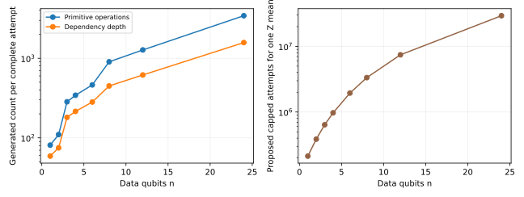
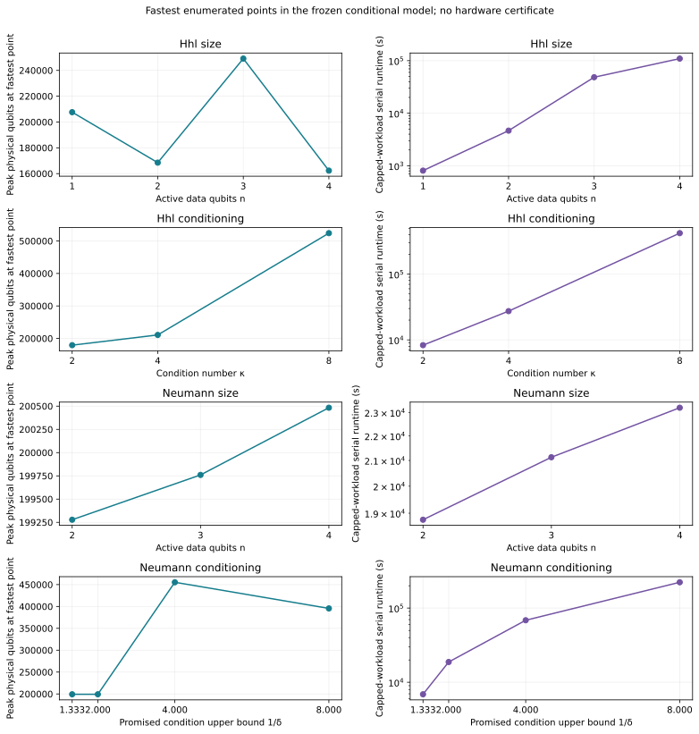

## Motivation and intuition

Linear systems occur in differential equations, regression and optimization. A quantum linear-system algorithm prepares a state proportional to $A^{-1}b$ and extracts a useful observable. This can be attractive when a matrix has economical quantum access and the downstream task needs a few expectations rather than the entire vector. Loading an arbitrary matrix or reading every solution entry can remove that attraction. The survey's end-to-end perspective makes access and output assumptions central {cite:p}`survey2025`.

The intuition is spectral: in an eigenbasis of $A$, divide each amplitude of $b$ by its eigenvalue. HHL stores the eigenvalue in a clock, uses it to control a flag rotation, then erases the clock {cite:p}`linsys_hhl2009`. QSVT instead applies a polynomial to a block encoding of $A$, avoiding the eigenvalue register {cite:p}`linsys_qsvt2019`. Both need normalization, a success procedure and readout.

:::{note} Implemented scope

HHL is implemented for a dyadic commuting matrix family, alongside a [spectrum-matched QSVT inverse](linear-systems/qsvt.md), a [Neumann-series LCU inverse](linear-systems/neumann-lcu.md) and an [interval-valid reciprocal QSVT](linear-systems/reciprocal-qsvt.md). The Neumann method has a uniform promised-interval polynomial bound and explicit known-input amplification. The broader QSVT method supplies a signed-interval reciprocal and an exact ideal-phase realization certificate. Small circuits are checked against independent classical solves; larger structured circuits have separate generation limits. These families can also be easy to solve classically. General sparse-matrix HHL, arbitrary vector loading, optimal-degree reciprocal compilation and integrated formal proofs remain further implementations. Surface-code outputs are conditional cost projections with excluded initialization and uncertified hardware synthesis.
:::

## Problem and output contract

Use

$$
A=\frac38I-\frac18X=
\begin{pmatrix}3/8&-1/8\\-1/8&3/8\end{pmatrix},\qquad
b=\begin{pmatrix}1\\0\end{pmatrix}.
$$

The eigenvalues are $1/4,1/2$, so $\kappa=2$. The unnormalized classical solution is $x=(3,1)^T$. The quantum output is

$$
|x\rangle=\frac{3|0\rangle+|1\rangle}{\sqrt{10}},\qquad
\langle Z\rangle_x=0.8.
$$

Our task is **one conditional $Z(q_0)$ mean**. The quantum output does not report all solution entries or their overall norm. The notebook computes the classical norm as a reference. Inputs start as clean zero qubits; default $b=|0\rangle$ requires no preparation gates. Other implemented inputs use explicit products of RY rotations.

## HHL from actual gates

A two-qubit clock represents the eigenphases of $U=e^{2\pi iA}$ exactly as labels 1 and 2. Controlled evolution uses

$$U=e^{3\pi i/4}R_X(\pi/2).$$

The global phase becomes a phase gate on the control and **must be retained**. QPE includes clock Hadamards, controlled powers, inverse QFT controlled phases and swaps. The reciprocal lookup tests each reachable clock label with X gates and a multi-controlled RY:

$$
|y\rangle|0\rangle_f\mapsto
|y\rangle\left(\sqrt{1-(C/\lambda_y)^2}|0\rangle_f+
\frac C{\lambda_y}|1\rangle_f\right),\qquad C=\lambda_{\min}=1/4.
$$

Inverse QPE erases the clock. Postselect clock 00 and flag 1; data values are unrestricted. On this exact-grid family the clock returns to zero on both flag branches. The accepted branch is $C A^{-1}|b\rangle$ with

$$p=C^2\|A^{-1}b\|^2=5/8.$$

The executed notebook supplies the complete four-wire circuit and its result. No opaque matrix-exponential gate or preloaded solution constructs this circuit.

```{embed} #linear-systems-hhl-circuit
```

```{embed} #linear-systems-hhl-results
```

The default normalized state differs from the independently solved state by about $7.2\times10^{-17}$ in numerical trace distance. This is floating-point evidence for the tested circuit, rather than a synthesis or all-input theorem certificate.

## Important variants

The [QSVT method page](linear-systems/qsvt.md) explains the modern variant. Three actual Pauli PREPARE/SELECT/unprepare calls and four projector phases implement an odd cubic on $B=A/.5=.75I-.25X$. Its values match a scaled reciprocal at this model's two eigenvalues. The accepted state is identical, with probability $5/32$ and three logical wires. Its lower width alone does not establish a lower complete-workload cost.

```{embed} #linear-systems-comparison
```

The [Neumann-series method](linear-systems/neumann-lcu.md) implements a finite reciprocal polynomial with exact rational Pauli aggregation for positive identity-dominant Hermitian matrices. Its bound holds across the promised interval, and its circuit includes input preparation, actual LCU access, source inverses and known-input amplification. Aggregation can grow exponentially. This is a distinct construction from QSVT phase synthesis.

[Reciprocal QSVT](linear-systems/reciprocal-qsvt.md) implements an odd geometric polynomial across a promised signed spectral interval. Its exact rational certificate covers the stored mathematical phase sequence; floating access/loading, compilation and physical synthesis have separate limits. Degree scales as $O(\delta^{-2}\log(1/\epsilon))$ for this transparent construction, rather than the optimal condition dependence of more advanced reciprocal polynomials.

General HHL needs a suitable Hamiltonian-simulation access model, eigenvalue precision and reciprocal arithmetic. General inverse QSVT needs a block encoding of normalization $\alpha$, a reciprocal polynomial across the promised spectral gap, and suitable amplification. Non-Hermitian systems need an explicit embedding or singular-value construction. Those extensions are outside the currently implemented families.

## Complexity and structured scaling

The original sparse-access HHL runtime scales as $\widetilde O(s^2\kappa^2\log N/\epsilon)$ under its input-preparation, Hamiltonian-access and solution-state assumptions {cite:p}`linsys_hhl2009`. This oracle-model statement is not our lookup circuit's explicit cost. Observable estimation adds sampling and readout. Here $N=2^n$.

Our generator supports

$$
A=\frac oD I+\sum_{j=0}^{n-1}\frac{w_j}D\frac{I-X_j}{2},
\quad D=2^m,\quad o>0,\quad w_j\ge0,\quad o+\sum_jw_j<D.
$$

Integer inputs specify the entire matrix access. Commuting terms allow analytic fast-forwarding: each controlled power uses at most one phase gate and $n$ controlled RX gates. Source work is $O(nm+m^2)$ evolution/QFT operations plus $L$ label-conditioned rotations, $L\le\min(2^n,2^m)$. This lookup can be exponential in clock precision. Multi-controlled operations are further decomposed before our recorded primitive counts.

Width is $n+m+1$; $\lambda_{\min}=o/D$, $\lambda_{\max}=(o+\sum w_j)/D$ and $\kappa=\lambda_{\max}/\lambda_{\min}$. For normalized $b$, acceptance obeys $p\ge1/\kappa^2$. Fresh repetitions can therefore cost $O(\kappa^2)$ per accepted output without amplification. For a Pauli mean, Hoeffding gives

$$M=\left\lceil\frac{2\ln(2/\delta_S)}{\epsilon_S^2}\right\rceil$$

accepted samples at statistical error $\epsilon_S$ and failure $\delta_S$. Allocate separate no-success failure $\delta_A$ across all slots:

$$
R=\left\lceil\frac{\ln(\delta_A/M)}{\ln(1-p)}\right\rceil,\qquad MR\ \text{complete attempts},
$$

with $R=1$ for $p=1$. Rejected attempts pay every gate and measurement. Clock spacing $1/D$ is exact for this family; it is not an arbitrary-spectrum approximation guarantee.

The [HHL scaling CSV](../assets/generated/linear-systems/hhl/scaling.csv) records actual primitive circuits at $n=1,2,3,4,6,8,12,24$, with $w_j=o=1$ and $m=\lceil\log_2(n+2)\rceil$. Then $\kappa=n+1$. Identified small rows are simulated; large-row ideal acceptance/workload predictions use the known spectral distribution. Classical convolution computes that distribution in $O(n2^m)$.



Generation allows 24 data/eight clock wires and 200,000 expanded operations. Dense references allow eight data wires; statevector validation allows 12 total wires. A separate bounded physical study covers n=1,2,3,4 and a two-data-qubit conditioning slice. The larger logical grid remains unprojected; these examples are not a hardware scaling law or quantum-advantage benchmark.

## End-to-end resource analysis

```{embed} #linear-systems-ledger
```

Default HHL has 34 CX, 32 continuous rotations, four final measurements and dependency depth 59 after recorded lowering. The [ledger](../assets/generated/linear-systems/hhl/logical-resources.json) records every primitive, source setting, digest, preparation and readout. With $\epsilon_S=.03$, $\delta_S=.005$ and separate $\delta_A=.005$, the proposal requires 13,315 accepted samples, 16 attempts per slot and at most 213,040 attempts. These are **unexecuted ideal workload proposals**.

The [HHL surface-code report](../assets/generated/linear-systems/hhl/surface-code.json) contains six computed Pareto points. It uses the existing illustrative $10^{-4}$ physical error rate, 100 ns gates/500 ns measurements, a $10^{-6}$ per-attempt synthesis-model allowance, and separate .005 physical-fault allowance over every capped attempt. Distances, factories, peak qubits and serial runtime are reported. Its fastest enumerated point projects 41,055 physical qubits and about 249 seconds across all capped attempts. The [QSVT report](../assets/generated/linear-systems/qsvt/surface-code.json) uses the same physical assumptions and its 1,171,720-attempt proposal. The frozen Grover baseline is unchanged.

**Synthesis and initialization limits apply prominently.** QDK's PSSPC rotation cost is a mean fit for random angles; it supplies no concrete synthesis sequence or operator-error certificate. Its scalar cannot certify postselected state accuracy or acceptance. Clean-state initialization timing/faults, classical coefficient/phase/lookup construction, compilation, reference solving and readout processing time are excluded. QDK abstracts Clifford scheduling; dependency depth is not a physical schedule.

If a separate certificate bounded the complete coherent pre-readout unitary error by $\eta<\sqrt p$, acceptance would be at least $(\sqrt p-\eta)^2$, conditional-state trace distance at most $\min(1,2\eta/\sqrt p)$, and Pauli bias at most $\min(2,4\eta/\sqrt p)$. **No such certificate is supplied.** Approximation, sampling/no-acceptance failure and physical faults remain distinct.

QASM exports describe complete **measured trials**. The pinned exporter can omit an overall compiled global phase; ledgers record it. These exports are not phase-preserving coherently controlled oracle specifications.

### Computed physical size and conditioning slices

The [13-case study](../assets/generated/linear-systems/physical-sweeps/manifest.json) includes HHL n=1,2,3,4 with $\kappa=n+1$, and a separate n=2 slice at $\kappa=2,4,8$ with maximum eigenvalue 0.5. These are actual small measured circuits with independent complete-trial checks. The Neumann panels concern different input matrices; they are not a matched algorithm-advantage comparison.

The common normalized-Z tolerance is 0.05: 0.01 algorithm bias, 0.01 postselection-adjusted synthesis bias and 0.03 sampling. Statistical, no-acceptance and physical-fault allowances are each 0.005, totaling 0.015 per separate case. There is no simultaneous guarantee across the grid. The profile is fixed at physical error $10^{-4}$, 100 ns gates and 500 ns measurements.

Every case charges all preparation, access, readout and rejected complete attempts. The uniform acceptance lower bound determines retries throughout; chosen-input numerical probabilities do not replace it. The $10^{-6}$ per-attempt QDK synthesis scalar is only hypothetically treated as a complete coherent error bound. No actual synthesis sequence or hardware-confidence certificate is supplied. Fresh logical-zero initialization/reset, classical preprocessing/readout, routing and decoder realization remain excluded.



[All physical selections and workload counts](../assets/generated/linear-systems/physical-sweeps/summary.csv) · [Reports and circuit links](../assets/generated/linear-systems/physical-sweeps/summary.md). Peak qubits times capped runtime is a rectangular space-time proxy. Existing default estimates retain their original contracts; the larger logical grid remains unprojected.

## Verification and formalization

HHL tests compare QFT with an independently constructed Fourier matrix, controlled evolution with matrix exponentials including identity phase, eigeninputs with expected clock labels, reciprocal flag probabilities with their formula, and complete states with NumPy solves. Coverage includes all-ones clock labels, spectators, product inputs, invalid parameters, lowering equivalence and actual X/Y/Z readout. Independent review also checked 30 random Kronecker-X systems and 33 boundary cases.

QSVT tests compare accepted blocks with an independently computed cubic, cover Y-containing words, verify preparation and measurement, reproduce numerical phases, and include a generic-spectrum case that correctly does not claim inversion. Its [phase evidence](../assets/generated/linear-systems/qsvt/phases.json) separates polynomial algebra from numerical coefficient/grid checks.

No Lean formalization is integrated. External proof libraries do not verify this Python generator without an explicit theorem/circuit connection and reproduced toolchain. Numerical simulation uses bounded Qiskit Statevector and independent NumPy/SciPy references.

Use the [locked Python environment](../requirements-lock.txt) with the public code package or source checkout:

```bash
python scripts/generate_linear_systems.py
python scripts/generate_linear_systems_qsvt.py
pytest tests/test_linear_systems.py tests/test_linear_systems_qsvt.py
```

Generate larger circuits separately from simulation/physical queries:

```bash
python scripts/generate_linear_systems.py --qubits 12 --no-sim \
  --no-scaling --no-estimate --output-dir artifacts/hhl-12
python scripts/generate_linear_systems_qsvt.py --word XXXXXXXXXXXX \
  --no-sim --no-scaling --no-estimate --output-dir artifacts/qsvt-12
```

The [executed notebook](../notebooks/linear_systems.ipynb) reuses these modules and provides optional live input controls. Saved output is static; controls need a Python kernel. The [public code package](../assets/generated/openquantum-code.zip) supplies shared access dependencies; individual module snapshots are source references.

Our implementations, prose and figures are original MIT work, using [Qiskit 2.6.2](https://github.com/Qiskit/qiskit/tree/2.6.2) ([Apache 2.0](https://github.com/Qiskit/qiskit/blob/2.6.2/LICENSE.txt)), NumPy/SciPy (BSD 3-Clause) and the audited QDK 1.34.0 adapter. Exact versions and hashes are recorded. See the [math](../appendices/mathematics.md) and [fault-tolerance](../appendices/fault-tolerance.md) appendices.
