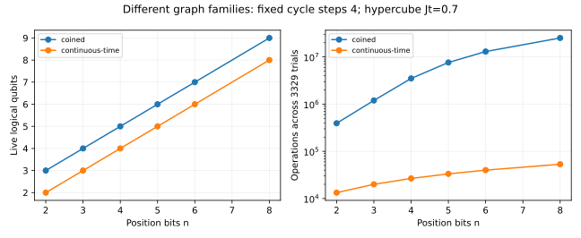
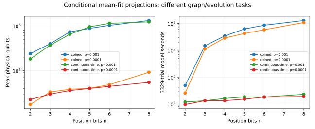

## Motivation and intuition

A classical random walk adds probabilities along possible routes. A quantum walk propagates amplitudes, so routes can reinforce or cancel when they meet. A coin supplies the direction register for a discrete walk; continuous-time walks instead evolve under a graph Hamiltonian. Quantum walks are useful primitives in search, sampling and quantum simulation, but their graph access, preparation and output requirements determine an application's cost {cite:p}`walk_aharonov2001`.

This chapter implements a **Hadamard-coin walk on a cycle**. Separate method pages implement [SKW-style marked-hypercube search](quantum-walks/skw-search.md) with an actual equality oracle and [continuous-time hypercube dynamics](quantum-walks/continuous-time.md). Their graphs, evolution and output contracts differ; the resource plots are not an equal-task advantage comparison.

:::{note} Implemented scope

Binary carry gates implement the coin-controlled cycle shifts. Small circuits are checked against independent permutation matrices and amplitude recurrences. Complete measured circuits, source code, size sweeps and conditional surface-code reports are supplied. No dense shift/evolution matrix constructs a quantum gate. The [bounded SKW search](quantum-walks/skw-search.md) separately checks its joint marked-state reflection, clean workspace and literal Clifford+T sequence. General graph access, other marked-search families, Szegedy walks, certified arbitrary-rotation synthesis and an integrated Lean proof remain further implementations.
:::

## Fundamental algorithm and task contract

Encode $N=2^n$ positions in $n$ bits and use one coin qubit. A step is

$$
U=S(H_c\otimes I),\qquad
S|c,x\rangle=|c,x+(2c-1)\bmod N\rangle.
$$

Chronologically apply the Hadamard to the coin, then shift. Coin zero moves left; coin one moves right. The coin occupies wire `q[n]`, and `q[0]` is the least significant position bit. The $n=1$ case has coincident left/right neighbors and is a degenerate two-vertex example; the main sweep starts at $n=2$.

The displayed input is position zero and coin $(|0\rangle+i|1\rangle)/\sqrt2$, prepared by H then S. Other implemented inputs are basis positions and coin zero or one. The output contract is **one return-event probability** after a stated number of steps. Every complete trial measures all position and coin wires. Classical decoding ignores every coin outcome and checks whether the position equals its start; it never postselects a coin value. A full histogram is a bounded illustration, not the same precision contract.

For a conditional increment, visit the position bits from high to low: flip bit $j$ when the coin and all lower bits are one, then flip bit zero under the coin. This implements binary carry without scratch wires. Reversing that sequence implements decrement. Sandwich the decrement with coin X gates to control it on zero. Both coin branches are coherent and their relative phase is retained.

```{embed} #walk-shift-circuit
```

One step has $2n+3$ **source instructions**: $2n$ controlled carry flips, two coin X gates and one coin Hadamard. Multi-controlled flips are subsequently decomposed. Let $C_j$ denote the implemented primitive cost of an X with $j$ controls. The actual shift costs $2\sum_{j=1}^{n}C_j+2$ plus the coin gate; it is not a constant-cost neighbor oracle. With $T$ steps, add input preparation, $T$ complete shifts/coins and $n+1$ final measurements. Width is $n+1$, with zero scratch ancillas. The compiled CSV records the cost of the pinned compiler instead of assigning every MCX unit cost.

## Important variants

The [continuous-time hypercube walk](quantum-walks/continuous-time.md) uses $H=J\sum_jX_j$ and $e^{-iHt}=\prod_jR_X(2Jt)$. This special graph factorizes into independent qubit rotations and is easy to simulate classically. It is not an implementation of arbitrary graph Hamiltonians.

The [implemented SKW-style search](quantum-walks/skw-search.md) uses a supplied equality mark, a binary direction coin and an explicit hypercube shift. Its default 11-wire circuit has an independent small reference and separate fixed-workload surface-code report. General graph search, multiple/application predicates and Szegedy transition-state preparation remain planned; their complexity is not inferred from either bounded walk.

## Small circuit demo

The default has three position bits, one coin and four steps. The diagram shows the complete coherent evolution, including H/S coin preparation and every controlled carry, before readout. The exported measured trial appends all four final measurements.

```{embed} #walk-coined-circuit
```

Its position law is $(1/8,0,3/8,0,1/8,0,3/8,0)$, so return probability is $1/8$. An independent stochastic cycle walk gives $(3/8,0,1/4,0,1/8,0,1/4,0)$, with return probability $3/8$. The classical walk is a comparator; the independent quantum permutation/recurrence is the correctness check. This finite bipartite cycle has parity restrictions, so neither curve should be interpreted as ordinary fixed-time convergence to a uniform distribution.

```{embed} #walk-coined-distribution
```

```{embed} #walk-coined-results
```

The notebook also runs the continuous-time $n=3,J=1,t=0.7$ example, checks its Hamiltonian and probabilities independently, and demonstrates the uniform hypercube distribution at $Jt=\pi/4$.

## End-to-end resource analysis

### Size, time and output scaling

The [logical scaling data](../assets/generated/quantum-walks/logical-scaling.csv) contains 12 actual compiled circuits: $n=2,3,4,5,6,8$ for the cycle at four steps and the hypercube at $Jt=0.7$. Every row includes basis/coin preparation, all primitive controlled shifts or rotations, final readouts and the declared number of trials. Statevector/recurrence checks are run for the cycle rows; bounded dense adjacency and analytic checks are run for the hypercube rows. These are different graph families with $2^n$ vertices.



For one fixed return indicator in $[0,1]$, Hoeffding gives

$$
M\ge\left\lceil\frac{\ln(2/\delta_S)}{2\epsilon_S^2}\right\rceil
=3329,\qquad\epsilon_S=0.03,\quad\delta_S=0.005.
$$

The same absolute sampling tolerance is used at every size; it is not a relative-error target for rare return events. The coherent synthesis-model allowance is separately $10^{-4}$ per output, with ideal algorithmic bias zero for the specified walk circuit. The total conditional observable allowance is $0.0301$. A separate physical-fault allowance $0.005$ spans all 3,329 trials. The [logical reports](../assets/generated/quantum-walks/demo-results.json) retain per-trial and shot-weighted gate/readout counts. Seeded NumPy draws from the validated ideal marginal are classical simulations, not hardware executions.

Our full statevector and recurrence store $O(2^{n+1})$ amplitudes; the dense reference stores $O(4^{n+1})$ matrix entries. Those are limits of the implemented checkers, not lower bounds on all classical simulation methods. At small step count a sparse reachable-position simulation can be much smaller, and the hypercube has a product formula. No classical-hardness or speedup claim follows from the circuit width.

### Conditional fault-tolerant reports

The [physical sweep](../assets/generated/quantum-walks/surface-code-scaling.json) runs 24 actual QDK queries: 12 circuits under each physical error profile $10^{-3}$ and $10^{-4}$, with 100 ns gates and 500 ns measurements. The graph and complete circuit remain explicit. Rotated surface-code data layouts and round-based factories are searched using the audited static adapter; Grover's frozen example is unchanged.

```{include} ../assets/generated/quantum-walks/physical-table.md
```



The reports retain code distances, factory choices, source/QASM digests, serial runtime and physical-fault model scores. Peak qubits are reused across serial trials. Peak times runtime is a rectangular space-time proxy, not an occupancy integral. The [coined](../assets/generated/quantum-walks/coined/measured-trial.qasm) and [continuous-time](../assets/generated/quantum-walks/continuous-time/measured-trial.qasm) primitive QASM exports describe complete measured trials. The pinned exporter may omit an overall compiled global phase; these exports are not phase-preserving specifications for later coherent control.

QDK's arbitrary-rotation cost is a **mean fit for random angles**, not a concrete Clifford+T sequence, approximation certificate or runtime-tail guarantee. Conditional confidence assumes its scalar bounds output-distribution variation; certified confidence remains unavailable. Physical initialization/reset timing and faults, processor routing and classical readout/control/communication latency are excluded. QDK abstracts Clifford scheduling, so the original circuit's dependency depth is not a measured hardware schedule. These exclusions prevent calling the result a fully certified hardware implementation.

### Separate marked-search workload

[Marked-hypercube search](quantum-walks/skw-search.md#end-to-end-resource-analysis)
counts the complete supplied oracle, five clean work wires, coin/shift,
literal 392-T/T† lowering and every measured trial for its prescribed
four-step instance. Its surface-code rows cost 12,288 ideal frequency-estimate
preparations, separately from the ten-trial ideal at-least-one search task.
These saved results have their own output and failure budget; they do not
extend the unmarked cycle scaling table or establish a cross-method advantage.

## Verification and formalization

The shift is compared directly with an independently built permutation on both coin branches and random coherent inputs. The complete walk is compared with an independently constructed $S(H\otimes I)$ matrix and a matrix-free amplitude recurrence. Tests cover carries/wraparound, bit order, relative phases, all input coins, parity, decomposition, all final measurements, invalid parameters and separate generation/simulation limits. Continuous-time tests use an independent bit-flip adjacency exponential and Hamming-distance product probabilities.

No Lean proof is integrated. A linked formal library would need a reproduced theorem, its input/register assumptions and a connection to these source circuits and their lowering. The available checks are bounded numerical/functional evidence.

## Reproduce and generate larger circuits

Use Python 3.12 and the [locked environment](../requirements-lock.txt) with the [public code package](../assets/generated/openquantum-code.zip):

```bash
python scripts/generate_quantum_walks.py --estimate
pytest tests/test_quantum_walks.py tests/test_quantum_walks_continuous.py
python scripts/generate_quantum_walks.py --qubits 10 --steps 2 \
  --no-sim --no-scaling --output-dir artifacts/walk-10
```

The cycle generator allows at most 12 position bits and 256 steps, subject to a conservative controlled-shift work guard and a 250,000-operation compiled-export cap. Temporary transpilation cost is not certified by the source guard. Actual statevector/recurrence checks stop at 12 total wires and 64 steps; dense cycle matrices stop at six position bits. The continuous-time module has its own [limits](quantum-walks/continuous-time.md#verification-and-formalization). Larger exports explicitly report simulation as unperformed.

The [notebook](../notebooks/quantum_walks.ipynb) includes optional live bounded controls. Static pages reuse its saved circuit/result outputs; controls need a local or Binder Python kernel, not a maintained website backend.

The prose, circuits and figures are original MIT work. Circuit construction, primitive lowering and ideal simulation use **Qiskit 2.6.2**, [tagged source](https://github.com/Qiskit/qiskit/tree/2.6.2), [Apache-2.0 license](https://github.com/Qiskit/qiskit/blob/2.6.2/LICENSE.txt) {cite:p}`walk_qiskit262`. NumPy/SciPy and Matplotlib retain their upstream licenses. Every result records the exact versions, source hashes, seed and CPU device. [Physics](../appendices/quantum-physics.md) and [fault-tolerance](../appendices/fault-tolerance.md) appendices explain the state, measurement and resource distinctions.

The numerical references use [NumPy 2.5.4](https://github.com/numpy/numpy/tree/v2.5.4) and [SciPy 1.18.1](https://github.com/scipy/scipy/tree/v1.18.1), with their [NumPy](https://github.com/numpy/numpy/blob/v2.5.4/LICENSE.txt) and [SciPy](https://github.com/scipy/scipy/blob/v1.18.1/LICENSE.txt) BSD-3-Clause license files. Original plots use [Matplotlib 3.11.2](https://github.com/matplotlib/matplotlib/tree/v3.11.2) and its [license](https://github.com/matplotlib/matplotlib/blob/v3.11.2/LICENSE/LICENSE). Conditional physical reports use the audited QDK 1.34.0 adapter and record its model sources.

## References

```{bibliography}
```
