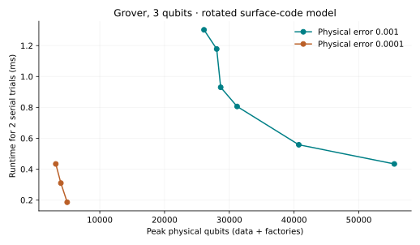

The first baseline estimates the circuit from the [Grover chapter](algorithms/grover.md): initialization, the explicit equality predicate, diffusion, and final measurements. It uses the open-source [Microsoft Quantum Development Kit](https://github.com/microsoft/qdk) and its local `qdk.qre` estimator. The baseline is a gate-based rotated surface code with round-based magic-state factories.

These results describe an **illustrative hardware model**. They do not establish an application speedup or a measured hardware performance guarantee. The equality oracle tests a known three-bit string; an application predicate or database access would need its own implementation and cost.

## Computed baseline

```{include} assets/generated/resources/table.md
```



Every plotted point is a returned estimator result, with its physical qubit count, runtime, factory information, model properties, and instruction provenance preserved in the report. The two summary choices can coincide for a small circuit.

The three algorithm qubits do not translate into three logical compute qubits under the estimator's scheduling model. Its logical ancillas, data code distance, and factories contribute to the physical count. These overheads can dominate a very small circuit; they are included rather than amortized over an unspecified larger workload.

For this instance, the exported rotations are exact Clifford or T operations. The QDK canonical application trace requires **28 T states and three measurements**, with no arbitrary-angle rotation synthesis. The estimator abstracts Clifford work and scheduling into its resource model, so the reported runtime is a model estimate rather than an exact schedule of the original Qiskit circuit. The initial pipeline rejects arbitrary-angle traces until their approximation-error budget is specified.

[Download every Pareto point as CSV](assets/generated/resources/grover-surface-code.csv) · [Download the full report as JSON](assets/generated/resources/grover-surface-code.json) · [Download the estimated OpenQASM circuit](assets/generated/grover/circuit.qasm) · [Download the estimation script](assets/generated/resources/estimate_resources.py)

## Hardware and error assumptions

The two profiles use physical error rates of $10^{-3}$ and $10^{-4}$, 100 ns gate time, and 500 ns measurement time. These are editable model inputs, not benchmarks from a specific processor. The estimator explores the rotated surface-code and round-based factory model combinations and returns a Pareto frontier.

For the default example, one state is marked among eight and two Grover iterations are used. The ideal success probability per circuit execution is

$$
p_{\mathrm{success}} = \sin^2\!\left(5\arcsin(1/\sqrt{8})\right) = 0.9453125.
$$

We set an overall failure target of 1%, reserve 0.5% for sampling failure and 0.5% for physical faults, and run two trials serially. Ideal sampling failure is $(1-p_{\mathrm{success}})^2\approx0.002991$. Each trial receives a physical-failure allowance of 0.25%. A union bound gives overall failure at most 0.7991% under the declared model and ideal verification assumptions. The report records the tighter bound from each returned estimate.

Peak physical qubits remain the per-trial peak because trials run serially. Runtime is multiplied by two. Quantum measurement time is included; classical verification and circuit compilation time are currently unmeasured and excluded. An application with input loading or a more complex predicate must extend this boundary before its estimate can be called end to end.

## Reproduce and inspect

In a project checkout:

```bash
python scripts/generate_grover.py
python scripts/estimate_resources.py
```

To reproduce using only public downloads, save the [OpenQASM circuit](assets/generated/grover/circuit.qasm), [matching circuit metadata](assets/generated/grover/logical-resources.json), [estimation script](assets/generated/resources/estimate_resources.py), and [locked Python dependencies](requirements-lock.txt) in one directory. In a Python 3.12 environment, run:

```bash
python -m pip install -r requirements-lock.txt
python estimate_resources.py --qasm circuit.qasm \
  --logical-metadata logical-resources.json \
  --output-dir resource-results --cache-dir estimator-cache
```

The estimator consumes the fully decomposed OpenQASM 3 file and records its SHA-256 digest. It rejects missing measurements and remaining custom gate declarations. Changing the qubit count or iteration count requires generating a matching circuit and passing matching `--n-qubits`, `--marked`, and `--iterations` arguments to the estimator. Package versions are embedded in the report.

The baseline uses the documented [local estimator installation](https://learn.microsoft.com/en-us/azure/quantum/install-run-resource-estimator), [OpenQASM application interface](https://learn.microsoft.com/en-us/azure/quantum/qre-supported-applications), [QEC and factory models](https://learn.microsoft.com/en-us/azure/quantum/qre-build-error-correction-models), and [result quantities and provenance](https://learn.microsoft.com/en-us/azure/quantum/qre-estimation-results). `EstimationTableEntry.runtime` is reported in nanoseconds and converted to milliseconds on this page.

## Next baseline extensions

- Add explicit reversible application predicates and state preparation, with loading and classical-output costs.
- Use [Qualtran](https://github.com/quantumlib/Qualtran) for symbolic large-instance logical resource counts; validate the handoff against small compiled circuits before physical estimation. Qualtran is an experimental preview, so pin versions and verify cost formulas.
- Compare factory choices, arithmetic, synthesis precision, and scheduling under the same input instance and error target.
- Calibrate selected surface-code memory experiments with [Stim](https://github.com/quantumlib/Stim), [Sinter](https://github.com/quantumlib/Stim/tree/main/glue/sample), and [PyMatching](https://github.com/oscarhiggott/PyMatching). Stim supports stabilizer operations and does not directly simulate T gates or Toffoli gates.
- Compare later co-designs using matched assumptions and physical qubit/runtime frontiers, retaining this surface-code report as the reference.
