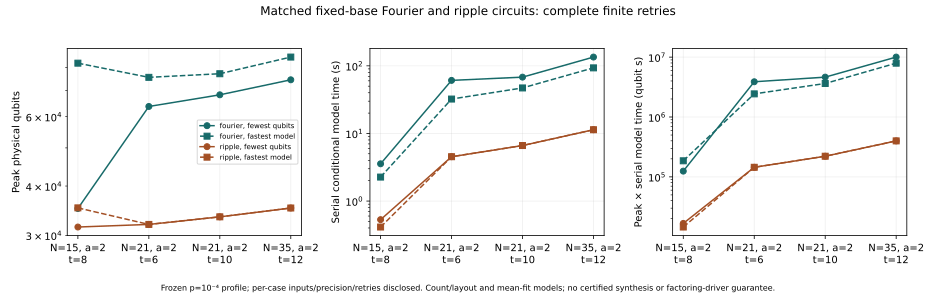

## Motivation and intuition

Factoring an integer becomes easier if we know the period of its modular powers. Shor's algorithm uses interference to reveal that period: a superposition of exponents is entangled with $a^x\bmod N$, and an inverse Fourier transform makes samples concentrate near multiples of the reciprocal order {cite:p}`shor_original_1997`. The classical gcd step turns suitable periods into factors. The survey discusses the application and its full resource context {cite:p}`survey2025`.

:::{note} Implementation status

The $N=15$ and $N=21$ examples execute **actual modular-add and modular-multiply circuits**, with numerical checks against independent classical answers. The parameterized generator constructs gates without an arithmetic lookup table or a dense unitary matrix. Logical scaling is measured separately from the bounded simulations. The default Fourier projection is joined by eight matched Fourier/ripple surface-code reports for four-, five-, and six-bit workloads. These use the audited QDK mean synthesis-cost model; they do not supply certified Clifford+T approximations or a general factoring benchmark. The [measured-AND companion](shor/measured-and.md) adds an executed ideal measurement-assisted replacement, bounded addition/order checks and materialized logical scaling; its physical comparison and mechanized proof remain pending.
:::

## Task, input and intuition

Given $N$ and a chosen base $a$ with $\gcd(a,N)=1$, the order is the smallest positive $r$ satisfying $a^r\equiv1\pmod N$. If a verified period is even, let $b=a^{r/2}\bmod N$. Nontrivial values of $\gcd(b-1,N)$ and $\gcd(b+1,N)$ give factors. Odd periods and $b=\pm1$ can fail, so they must not disappear from success accounting.

Our input is the classical pair $(N,a)$. It specifies ordinary gate constants and the bit width $n=\lceil\log_2N\rceil$; there is no external database or amplitude-loading oracle. The work register begins at $1$, while the $t$ exponent qubits begin in a uniform superposition. Controlled multiplication by $a^{2^j}\bmod N$ entangles the $j$th exponent bit with the modular-power register. All work ancillas are uncomputed before the inverse QFT and exponent readout.

## Fundamental algorithm and real arithmetic

The arithmetic follows Fourier addition and compute–swap–uncompute multiplication {cite:p}`shor_draper_2000,shor_beauregard_2003`, using an original **Qiskit 2.6.2** implementation. Qiskit is Apache-2.0 software; see its [upstream repository](https://github.com/Qiskit/qiskit) and our [MIT implementation](../assets/generated/shor/shor.py).

For $0\le y<N$, a modular addition uses an $(n+1)$-bit accumulator and one borrow flag. In the Fourier basis it adds a constant $c$, subtracts $N$, conditionally restores $N$ after inspecting the high bit, and removes the borrow information using the relation between the result and $c$. QFTs, controlled phase gates, X gates and CX gates implement every step. Addition by $c$ is controlled; the subtract/restore work cancels on inactive control branches. The accumulator's high bit and borrow flag return to zero.

To multiply by $a$, add $a2^j\bmod N$ into a zero accumulator, controlled by each input bit. Swap the input with the result under the exponent control. Then subtract the binary-weighted multiples of $a^{-1}\bmod N$ controlled by the new input bits. The old input is erased because $a^{-1}(ax\bmod N)\equiv x\pmod N$. This includes the inverse arithmetic, rather than charging an opaque modular-multiplication box.

The contract requires $x<N$, a zero accumulator and a clean flag. Outside that subspace the same gate circuit remains reversible, but we assign it no modular-arithmetic meaning. All QFT angles are numerical representations of exact analytic angles; fault-tolerant synthesis is a separate layer.

In-memory arithmetic preserves the relative phases needed for coherent controls. The pinned QASM exporter omits the compiled circuit's overall global phase, recorded in the ledger. Our QASM files describe complete measured trials with unchanged probabilities; they are not specifications for a phase-preserving oracle to be coherently controlled again.

## Important variants

| Variant | Benefit or tradeoff | Status here |
|---|---|---|
| Full-register QPE with exact-angle Fourier arithmetic | Directly inspectable coherent circuit; large rotation count | Implemented |
| Semiclassical inverse QFT | Measures and reuses exponent qubits with classical feedback {cite:p}`shor_griffiths_niu_1996` | [Implemented recycled-control circuit](shor/factoring-driver.md); adaptive physical projection pending |
| Approximate Fourier arithmetic | Omits small rotations with a circuit-wide approximation budget | Planned; current gates are not truncated |
| MAJ/UMA ripple-carry modular arithmetic | More work registers; fewer arbitrary rotations in the checked examples | [Implemented circuits and comparison](shor/ripple-arithmetic.md) |
| Optimized modular multiplication | Can change arithmetic coefficients, non-Clifford cost and ancillary space | Planned |

Beauregard's smaller-qubit algorithm uses recycled control qubits and approximate Fourier transforms. Its quoted complexity and $2n+3$ width do not describe our full-register, exact-QFT implementation.

### Arithmetic and classical recovery improvements

The arithmetic, phase sampling and classical recovery can be improved independently. We should name the complete construction being compared: an optimized Shor order finder, an Ekerå–Håstad short-discrete-logarithm reduction for RSA moduli, and Regev's factoring algorithm have different input and success contracts. The existing N15/N21 generators remain the implemented baseline.

| Direction | What changes | What the end-to-end comparison must retain | Status here |
|---|---|---|---|
| Temporary logical ANDs and measurement-assisted uncomputation | Reduce the non-Clifford cost of reversible addition {cite:p}`shor_gidney_addition2018` | Ancillas, measurements, feedback, restoration and coherent controls | [Executed bounded ripple replacement](shor/measured-and.md); optimized Gidney arithmetic, matched physical costs and mechanized proof remain planned |
| Windowed modular exponentiation | Trade precomputed lookup tables and workspace for less repeated arithmetic; recent circuit optimization also targets this path {cite:p}`shor_gidney_ekera2021,shor_luongo_dac2025` | Actual reversible lookup, table construction, unlookup, window sizes, memory, readout and recovery | Planned |
| Residue arithmetic with truncated outputs | Recover sufficient modular-exponentiation information using less quantum workspace {cite:p}`shor_chevignard2025` | Approximation and truncation parameters, success probability, required samples and the chosen factoring reduction | Planned |
| Shared lookups, retained checkpoints and lazy residues | Share an address across residue-prime lookup words and defer reductions while preserving required outputs {cite:p}`shor_shared_lookups_2026` | Word widths, overflow bounds, checkpoint storage, uncomputation and the architecture's lookup/transport cost | Planned; November 6, 2026 preprint with external mathematical arguments and reference-simulator benchmarks |
| Improved classical order recovery | Search near the measured phase and recover missing factors of the order {cite:p}`shor_ekera_success2024` | The measured distribution, exponent width, bounded search work, output verification and quantum retries | [Implemented bounded same-circuit comparison](shor/order-recovery.md); the original continued-fraction baseline is retained |
| Complete classical factor recovery from one sampled order | Recover the complete factorization from the order of a uniformly chosen group element {cite:p}`shor_ekera_complete2021` | Uniform-base assumption, prime-power handling and classical recovery cost | Planned; distinct from the present fixed-base gcd rule |

Ekerå's high-success order-recovery result is especially useful for a matched experiment: it changes classical processing without requiring a longer exponent register or another quantum execution {cite:p}`shor_ekera_success2024`. It does not imply that the current fixed base is always useful. For example, the preserved N33/base2 workload has a period whose half-power is −1; a comparison must use the actual new recovery contract and must not overwrite that negative result.

The [Quaspy library](https://github.com/ekera/quaspy/tree/8040affdf08814ef7d451d9797d28f7645856151) supplies relevant order-finding distribution simulators and classical post-processing. At the inspected commit its package metadata is **1.0.0a1**, Python ≥3.10, MIT, with `gmpy2` and `secret` dependencies. The [bounded recovery implementation](shor/order-recovery.md) uses its exact source as an algorithm reference, then implements integer recovery in original standard-library code and compares both rules on outputs from our actual arithmetic circuits. Its upstream license is retained; no Quaspy package dependency is added. All default orders are fully smooth under the chosen bound, so the classical shortcut can recover them without a quantum frequency. The comparison retains the original continued-fraction scoring and the N33/base2 factor failure, and supplies no quantum-advantage or physical-improvement claim. Quaspy's distribution simulators remain references rather than gate-by-gate modular-exponentiation implementations.

### Regev-style factoring is a separate algorithm family

Regev's published algorithm uses approximately $\sqrt n$ independent quantum executions, each with a gate count of order $n^{3/2}$ up to logarithmic factors, followed by classical lattice processing. Its correctness relies on a number-theoretic conjecture, and the paper explicitly leaves practical physical improvement unresolved {cite:p}`shor_regev2025`. The gate count is per execution: the repetitions and classical lattice work must remain in the total cost.

Ragavan and Vaikuntanathan reduce the quantum workspace while keeping the smaller per-run circuit and make classical recovery tolerate a constant fraction of corrupted runs {cite:p}`shor_ragavan2026`. The inspected associated manuscript states  $O(n\log n)$ qubits and  $O(n^{3/2}\log n)$ gates per run, with  $O(\sqrt n)$ runs. These asymptotic statements use the papers' arithmetic model, rather than the current book generator's simple cubic arithmetic. Tolerance of corrupted samples is a recovery property; a physical implementation still needs error correction, synthesis and a failure budget.

This deserves a separate planned page beneath the factoring chapter when we implement it. That page should show a small multidimensional exponentiation circuit, actual lattice recovery, the number-theoretic assumption, and a comparison with the same factoring/output/success task. No Regev circuit or physical estimate is implemented here yet.

## Small circuits and independent answers

The first example is $N=15,a=2,t=4$. Its **14-wire** circuit includes four exponent bits, four modular-power bits, a five-bit accumulator and one borrow flag. In the figure, `cM2` and `cM4` are controlled multiplication by two and four modulo 15. Modular exponentiation computes each circuit constant without computing the order. Constants that equal one produce identity multipliers and are omitted; the favorable order of this tiny instance is disclosed in the scaling table.

```{embed} #shor-circuit
```

The independent classical sequence has order four. The actual arithmetic circuit gives probability $1/4$ at exponent outcomes $0,4,8,12$, with maximum probability discrepancy about $2.14\times10^{-14}$. All auxiliary wires are zero with probability within $10^{-13}$ of one.

```{embed} #shor-probabilities
```

Continued fractions reconstruct a denominator from $y/2^t$. Modular exponentiation verifies each candidate, then the gcd factors are checked. A verified denominator is a period and can be a multiple of the minimal order at finite precision; no hidden order enumeration or candidate trial division is used. Here $y=4,12$ give period four and factors $3,5$; $y=0,8$ fail. Thus the **ideal fixed-base factor probability is $1/2$ per full trial**. Eight independent complete trials make ideal sampling failure at most $1/256<0.005$. The notebook executes eight seeded draws from the validated circuit distribution and shows every outcome, including failures.

For $N=21,a=2,t=6$, the order is six and does not divide the 64-point Fourier grid. The actual **18-wire** circuit is checked against the finite Fourier sum, not an assumption of exact peaks. With the same reconstruction rule, ideal factor success is about **0.287989**, requiring **16 full trials** for ideal sampling failure at most $0.005$. Three exponent bits for this instance give no reconstructable factor success under this rule; more repetitions cannot fix that precision choice.

```{embed} #shor-second-instance
```

## End-to-end resource analysis

### Space and time scaling

The complete coherent circuit uses

$$Q=t+2n+2$$

logical wires. There are at most $t$ nonidentity controlled multipliers, each with $2n$ modular additions and $n$ controlled swaps. Exact QFT addition costs $O(n^2)$ elementary operations, so this implementation has **$O(tn^3+t^2)$ gates**, or **$O(n^4)$ for $t=2n$**. This deliberately transparent arithmetic is not an optimized factoring resource benchmark. The [measured scaling CSV](../assets/generated/shor/scaling.csv) gives actual expanded counts for $N=7,15,21,33$ with $t=2n$; these larger materializations are not claimed simulated. Instance-specific identity powers affect the observed counts.

With $t=2n$, the grid spacing is at most $1/N^2$. A closest sample to a phase $s/r$ is then fine enough for continued-fraction reconstruction; recovery of $r$ still requires an appropriate numerator, and factoring can still fail after a valid period. For a fixed instance with independently established ideal success $p$, $R=\lceil\log\delta_{\rm sample}/\log(1-p)\rceil$ complete trials give the ideal retry bound. Total logical work is $R$ times the complete trial count. The measured toy values of $p$ must not be extrapolated to arbitrary integers.

The $N=15,t=4$ export contains **8,665 unitary primitives and four exponent measurements** per full trial. Its dependency depth is a compiler graph property, not physical runtime. Preparation, all arithmetic and uncomputation, inverse QFT and readout are included. The eight-trial contract charges 69,352 primitive operations including readout. Classical constant construction, continued fractions, modular exponentiation and gcd verification run on the classical processor; generated metadata records measured construction/compilation and seeded postprocessing timings, separately from physical projections. Their classical bit-complexity is polynomial using ordinary modular arithmetic. The enumerated order reference is bounded validation work and is not part of the algorithm.

This is **fixed-base** success accounting. A general factoring driver also needs classical preliminary checks, random-base choices, noncoprime-base gcd successes, unfavorable periods, phase-precision selection and their combined success bound. Those parts are not projected by this report.

### Fault-tolerant analysis

The [computed surface-code report](../assets/generated/shor/surface-code.json) imports the entire measured circuit into **QDK 1.34.0** and models eight serial executions. It uses the illustrative frozen hardware profile $p=10^{-4}$, 100 ns gate time and 500 ns measurement time, a separate **0.005 physical-fault allowance over all eight trials**, and a **$10^{-5}$ synthesis-model allowance per trial**. The independent ideal sampling allowance is also 0.005. These distinct quantities do not establish a certified combined factoring confidence.

QDK's canonical trace has 2,737 arbitrary rotations, 1,599 exact T instructions and four measurements. Its mean-fit allocation is 20 T states per arbitrary rotation, totaling 56,339 T states per execution. The modeled synthesis scalar is about $6.89\times10^{-6}$ per trial. It supplies neither a concrete synthesis sequence nor a per-angle approximation certificate. The QDK layout also abstracts Clifford scheduling.

For scaling this **conditional mean-cost model**, if a new compiled circuit has $L>0$ canonical arbitrary rotations and $T_0$ exact T instructions, the audited allocation uses

$$\tau=\max\!\left(12,\left\lceil4.86+0.53\log_2(L/\epsilon_{\rm model})\right\rceil\right),\qquad T_{\rm model}=R(T_0+L\tau).$$

This model grows as $O(RG\log(G/\epsilon_{\rm model}))$ for $G$ logical gates. It is not a certified synthesis bound. Physical qubits and elapsed time additionally depend on the data code distance, layout and factory concurrency; each new $(n,t,R)$ workload needs the same explicit surface-code search. We provide no unexecuted physical scaling curve as a validated result.

| Peak physical qubits | Data code distance | Modeled time per trial | Modeled time for eight trials |
|---:|---:|---:|---:|
| 32,880 | 13 | 0.52104 s | 4.16832 s |
| 32,920 | 11 | 0.44088 s | 3.52704 s |
| 35,540 | 9 | 0.36072 s | 2.88576 s |
| 40,740 | 7 | 0.28056 s | 2.24448 s |

These are conditional Pareto points for the default $N=15,a=2,t=4$ workload. They include data layout and magic-state factories, but exclude classical compilation/postprocessing time and external input loading. Qubits start in the circuit model's zero state; there are no explicit reset instructions. No practical advantage or worst-case runtime certificate is claimed. See [fault-tolerance background](../appendices/fault-tolerance.md).

### Matched physical scaling at four, five and six bits

The [matched workload study](../assets/generated/shor-scaling/study.json) compares this exact-angle Fourier arithmetic with the [MAJ/UMA ripple-carry variant](shor/ripple-arithmetic.md) {cite:p}`shor_draper_2000,shor_beauregard_2003,shor_ripple_cuccaro_2004`. It constructs and lowers complete prepared and measured circuits, including every controlled modular power and its uncomputation. The original implementations use Qiskit 2.6.2; QDK 1.34.0 supplies the conditional surface-code and PSSPC layout model.

The primary series fixes $a=2$ and the resolution rule $t=2n$: $(N,t)=(15,8),(21,10),(35,12)$, with $n=\lceil\log_2N\rceil=4,5,6$. The N15/t8 row has a larger phase register than the preserved N15/t4 default above. The existing N21/t6 demonstration is included as a separate lower-precision comparison. Eight native reports contain **19 Pareto points** for these four matched workloads.

| Integer bits $n$ | Fixed input | Ideal factor success per trial | Complete trials $R$ | Fourier / ripple logical qubits |
|---:|---|---:|---:|---:|
| 4 | $N=15,a=2,t=8$ | 0.5 | 8 | 18 / 24 |
| 5 | $N=21,a=2,t=6$ | 0.287989 | 16 | 18 / 25 |
| 5 | $N=21,a=2,t=10$ | 0.330843 | 14 | 22 / 29 |
| 6 | $N=35,a=2,t=12$ | 0.330686 | 14 | 26 / 34 |

Each $R$ is the smallest integer satisfying $(1-p)^R\leq0.005$ for its bounded ideal fixed-base contract. Both methods match $N,a,t$, input register $1$, full exponent readout, postprocessing rule, $R$, compiler policy and requested budgets. The study charges $R$ **complete trials**. For N35, Fourier/ripple circuits contain 144,044 / 212,293 primitive operations per trial, including readout; fourteen trials charge 2,016,616 / 2,972,102 operations.

The hardware profile remains physical error $10^{-4}$, 100 ns gate time and 500 ns measurement time, with the same surface-code/factory models and ISA graph pruning disabled. The whole-workload physical-fault allowance is 0.005. A separate whole-workload **synthesis-model allowance** is fixed at $8\times10^{-5}$ and divided as $8\times10^{-5}/R$ per trial. This preserves the default eight-trial allocation while holding the aggregate allowance fixed as $R$ changes. The actual mean-fit scalar can be smaller and is recorded per trial and over all serial trials. It does not certify a concrete synthesis sequence or combined factoring confidence.

```{include} ../assets/generated/shor-scaling/resource-table.md
```



The table selects the fewest-qubit and fastest-model Pareto choices separately; the [CSV](../assets/generated/shor-scaling/scaling.csv) records both. Peak qubits multiplied by serial model time is their reported product, rather than an integral of active qubits over time. The full reports retain source dependency depth, canonical rotation/T counts, synthesis allocation, code distance, factories and all Pareto points.

The primary series supplies three bounded size points under a declared input and precision policy. Orders and identity powers differ across integers, and N15 has especially favorable identity multipliers. Ripple has more logical wires and compiled Boolean work; the declared model favors its lower arbitrary-rotation workload here. QDK reduces the circuit to canonical non-Clifford/measurement counts on placeholder wires, and PSSPC does not preserve the actual Clifford dependency graph. The projected times therefore remain conditional on that abstraction; the study is neither a universal physical scaling fit nor a classical factoring benchmark.

The old circuit-materialization control $N=33,a=2,t=12$ is retained with **zero ideal factor success and no finite-retry physical factoring projection**. Its order is ten and $2^5\equiv-1\pmod{33}$, so the verified-period gcd rule cannot return a nontrivial factor. More precision or retries cannot repair that base. Its actual circuits and logical counts remain available in the study, with the unsupported retry contract labeled explicitly.

Every trial includes input-$1$ and exponent preparation, controlled modular powers, accumulator/constant/carry/borrow handling, inverse arithmetic, inverse QFT and all exponent measurements. Serial executions assume fresh logical-zero inputs. Calibrated physical initialization/reset, external I/O, classical constant construction and CF/gcd verification latency, routing and decoder timing are excluded from the physical clock; diagnostic work and wall times are separate. These fixed-base reports do not project the combined success, stopping behavior or runtime of the adaptive random-base or recursive [factoring driver](shor/factoring-driver.md).

### External end-to-end resource references

The Gidney–Ekerå construction is a useful external end-to-end reference: it combines optimized arithmetic and recovery with a surface-code layout, magic-state factories, repeated attempts and a specified controller reaction time {cite:p}`shor_gidney_ekera2021`. Its RSA-2048 estimate uses 20 million noisy qubits and an expected eight-hour runtime under a particular nearest-neighbor hardware model. Those numbers are not extrapolations from our N15/N21 circuits.

A later Gidney preprint trades more time for less space, using approximate residue arithmetic, dense idle storage and smaller magic-state production. Its headline estimate is below a million noisy qubits and below a week, with the same stated physical error, cycle and controller assumptions as the earlier reference {cite:p}`shor_gidney2025`. The paper's dense-storage choice uses yoked surface codes, whose published memory results concern a hierarchical code over a nearest-neighbor square grid {cite:p}`shor_yoked2025`. A lower memory cost is not automatically a faster complete algorithm: transfers between storage and computation, factory throughput, arithmetic retries and controller latency still matter.

We will treat these as **external conditional resource models**, not as validated improvements to this book's frozen baseline. A matched co-design comparison must hold the factoring problem, accepted input class, output, total failure probability and hardware assumptions fixed, and report physical qubits, runtime and spacetime volume. A new code or memory architecture also needs its own noise, operation and scheduling model.

The 2025 paper's [Zenodo code-and-assets record](https://doi.org/10.5281/zenodo.15347487) is an exact upstream starting point. The inspected record has a 6,220,929-byte `code.zip` and a CC-BY-4.0 license. We have inspected the record metadata, not executed that archive. The 2021 arXiv source separately provides `estimate_costs.py` and related ancillary files.

The November 2026 shared-lookup preprint provides a further arithmetic candidate and an [exact supporting archive](https://doi.org/10.5281/zenodo.23991044), whose metadata declares CC-BY-4.0 {cite:p}`shor_shared_lookups_2026`. We inspected the manuscript and archive metadata, not the archive's executable source. Its comparisons bind logical-qubit budgets and reference-simulator counts; wider shared lookup words can change the runtime benefit on another architecture. Neither its gate reductions nor its conditional timing transfers are a reproduced improvement to our frozen factoring workload.

## Verification and formalization

The dedicated tests check positive-exponent QFT matrices, modular addition over valid basis inputs and active/inactive controls, multiplier semantics, auxiliary cleanup, coherent relative phases and decomposition. Full $N=15$ and $N=21$ phase marginals are compared with an independently evaluated Fourier sum over residue classes. This tests the actual circuit, rather than constructing a reference arithmetic matrix and calling it an implementation.

An independent review additionally checked 1,743 modular-adder branches and 102 multiplier branches through $N=21$, with full complex-amplitude discrepancies below $4\times10^{-14}$. Numerical tests cover the stated bounded inputs; they are not a proof for every width.

### Checks for the physical scaling study

The scaling study derives ideal probabilities from independent FFTs of classical modular-power residue indicators and compares them with the geometric Fourier reference. The actual continued-fraction, modular-period verification and gcd rule defines factor success. The independent order reference is evaluated after circuit materialization and never supplies gate constants or chooses phase precision.

Every distinct ripple power multiplier is checked on all valid input/control branches with clean work restoration. Independent review checks the corresponding Fourier powers on coherent superpositions over the valid domain. Tiny actual full circuits and controlled multipliers are compared with independent classical and complex-amplitude answers. Bounded sparse simulation also rechecks the N15/t8 and N21/t6 ripple circuits. The larger N21/t10 and N35/t12 materializations have arithmetic and resource checks; no fresh full-state simulation or formal proof is claimed for them. Exported QASM, native-input hashes, readout mappings, complete retry counts and model allocations are checked separately.

### Available external formalization

No Lean formalization is integrated for this generator.

Formalization is available at several layers. Peng and colleagues published an end-to-end ideal Shor development in Coq, including returned-factor correctness and a repeated-trial failure bound {cite:p}`shor_verified_peng2023`. The [inspected SQIR source](https://github.com/inQWIRE/SQIR/tree/134fb942265091baa3e3972f78f72da41827351f/examples/shor) contains the theorems `end_to_end_shors_correct` and `end_to_end_shors_fails_with_low_probability`, extraction-oriented circuit correspondence, and logical gate-count results. Coq/Rocq and Lean are different proof assistants. The upstream extraction route explicitly retains assumptions about OCaml floats, Zarith arithmetic, the measurement simulator and handwritten I/O.

A 2026 Lean preprint is a concrete additional reference {cite:p}`shor_lean_zhang2026`. The [inspected Lean-QuantumAlg source](https://github.com/QudeLeap/Lean-QuantumAlg/tree/971dc8be8a153a116b6d7cd748f984d545861b00) exposes separate declared-oracle Shor, measured-arithmetic RSA logical models and fixed RSA-2048 endpoints. The declared-oracle model's oracle coordinate is not a compiled modular-arithmetic gate count. The RSA endpoint is an Ekerå–Håstad-style model with explicit accepted-key and success assumptions; its logical resource ceilings use exact arbitrary one-qubit semantics and supply neither a Clifford+T approximation certificate nor physical surface-code runtimes. The P-256 construction concerns elliptic-curve discrete logarithms rather than integer factoring.

These are **inspected external references, not reproduced or integrated proofs**. The Lean paper is an unreviewed preprint, and the inspected October source is later than its July manuscript. A proof-reproduction artifact must pin a source commit, dependencies, exact theorem and complete assumption inventory, then record a successful kernel build. Verifying this book's implementation additionally requires a correspondence between our arithmetic/export/lowering and the proved model. A linked repository does not establish that correspondence.

The inspected Lean source is Apache-2.0; its `lean-toolchain` requires Lean 4.33.1 and its Lake manifest resolves mathlib 4.33.1 to an exact commit. The later framework paper explains its execution-linked contract {cite:p}`frontier_lean_framework_2026`. The inspected MIT-licensed SQIR package instead declares Coq ≥8.16, QuantumLib ≥1.6.0 and Interval ≥4.9.0; its Shor README's extraction instructions report a historical Coq 8.15.2 test. Those are different environment records. A local reproduction must resolve and lock the chosen proof/extraction environment rather than treat either README as a successful build here.

## Reproduce, change the input and download

Use Python 3.12 and the [locked environment](../requirements-lock.txt), or install the downloadable code package. The [notebook](../notebooks/shor.ipynb) reuses the same source and offers editable bounded parameters in a live local or Binder kernel. The static website needs no kernel backend.

```bash
python scripts/generate_shor.py --physical
pytest tests/test_shor.py
python scripts/generate_shor.py --modulus 33 --base 2 --phase-bits 12 \
  --no-sim --no-scaling --output-dir artifacts/shor-33
```

The generator permits at most 12 input bits and 24 exponent bits, subject to a conservative arithmetic-work preflight and a 500,000 expanded-operation cap. **Statevector execution is separately capped at 18 total wires.** The guard does not promise efficient simulation or compilation of every accepted input. Exact statevector memory grows as $2^Q$; large arithmetic simulations need a different recorded computation job.

To reproduce the separate matched scaling study:

```bash
python scripts/generate_shor_scaling.py
pytest tests/test_shor_scaling.py tests/test_shor_scaling_artifacts.py
python scripts/generate_shor_scaling.py --case 33:5:12 \
  --output-dir artifacts/shor-33-base5
```

This study generator has separate caps: six integer bits, twelve phase bits, forty declared qubits, 250,000 actual lowered operations per trial, 64 complete retries, five cases and eight native queries per sweep. Each native query runs in an isolated process with at most 90 seconds of wall time. Generation/retry guards, native-query limits and unavailable or timed-out native jobs can leave a workload without a computed physical report. Diagnostic simulation/check caps are separate: those checks can be recorded as `not_run` or partial coverage even when a conditional resource estimate of the materialized circuit is available. Detached code downloads can omit historical baseline files; their absence is labeled separately from verified preservation in a source checkout.

The study records exact parameters, package versions, source revision/content hashes, diagnostic coverage, whole-workload budgets and limits. Its per-method QASM and resource reports are linked through the manifest. The N15/t4 default and frozen Grover baseline retain their original meanings.

- [Executable notebook](../notebooks/shor.ipynb)
- [Original arithmetic module](../assets/generated/shor/shor.py) and [MIT license](../assets/generated/shor/LICENSE.txt)
- [Complete decomposed measured QASM](../assets/generated/shor/circuit.qasm)
- [Logical ledger, parameters, seeded samples and environment](../assets/generated/shor/logical-resources.json)
- [Conditional surface-code projection](../assets/generated/shor/surface-code.json)
- [Actual circuit scaling data](../assets/generated/shor/scaling.csv)
- [Matched physical study and per-method circuits](../assets/generated/shor-scaling/study.json), [scaling CSV](../assets/generated/shor-scaling/scaling.csv) and [tiny-circuit checks](../assets/generated/shor-scaling/tiny-verification.json)

## References

```{bibliography}
```
